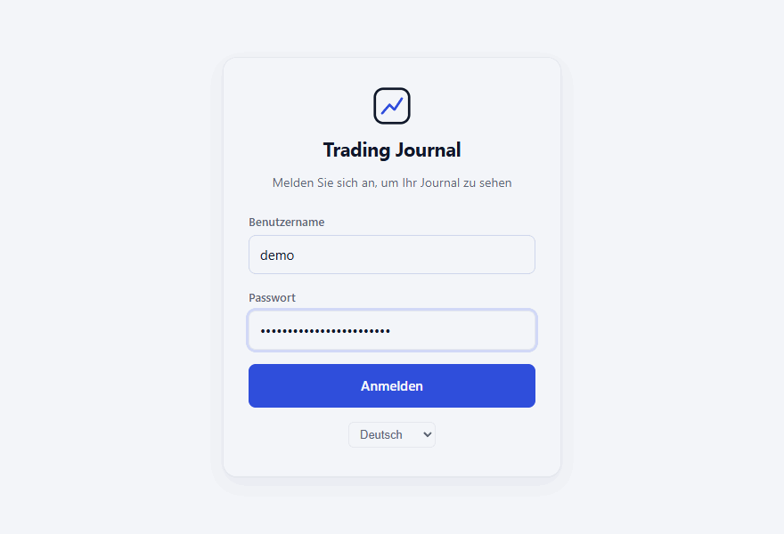
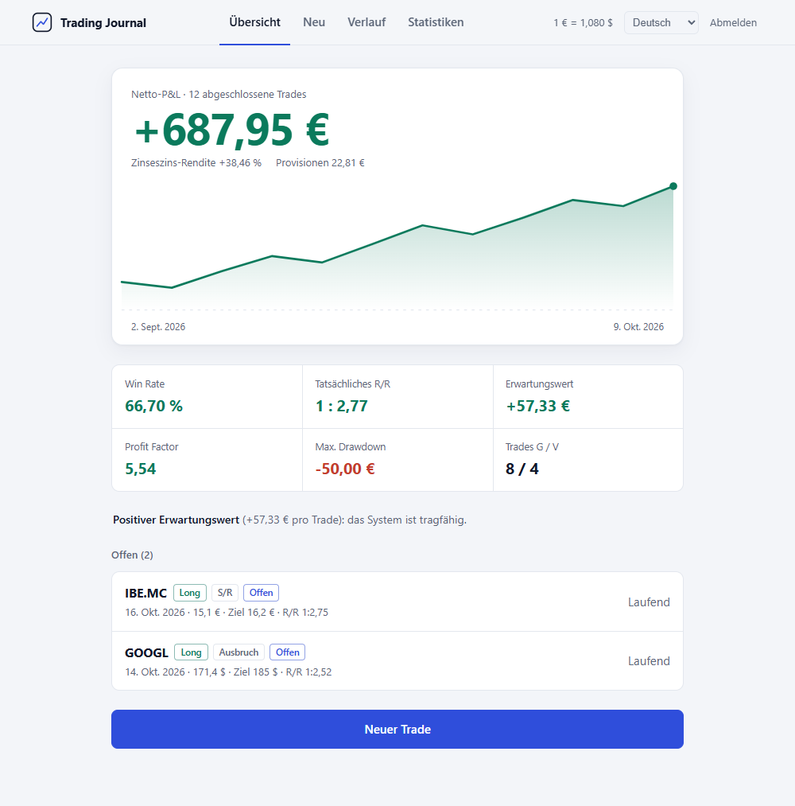
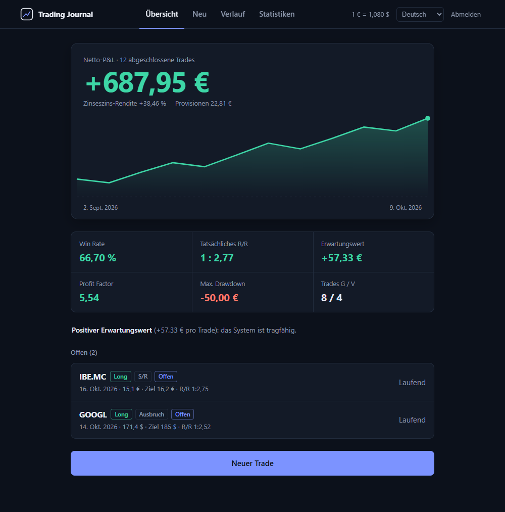
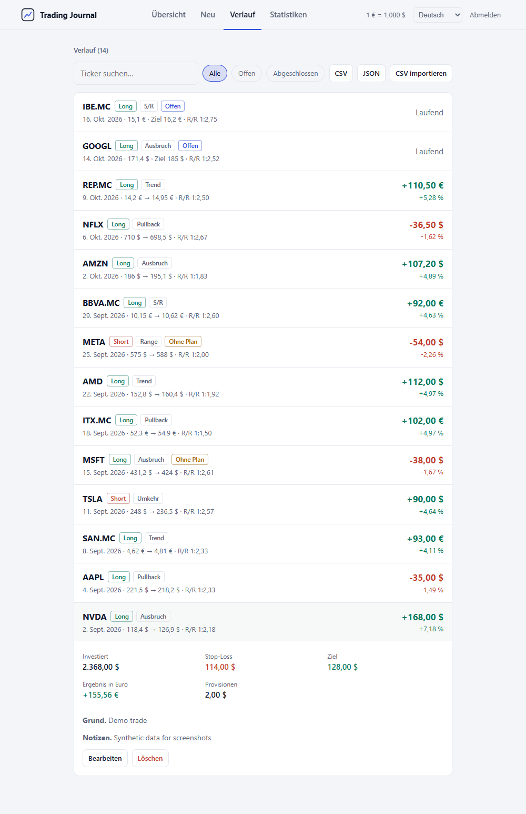
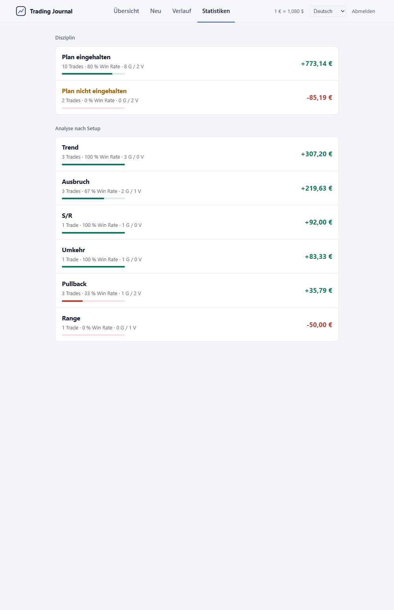
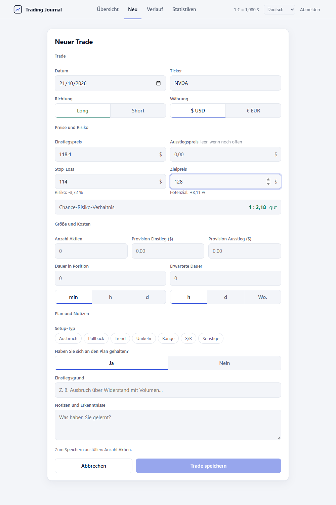
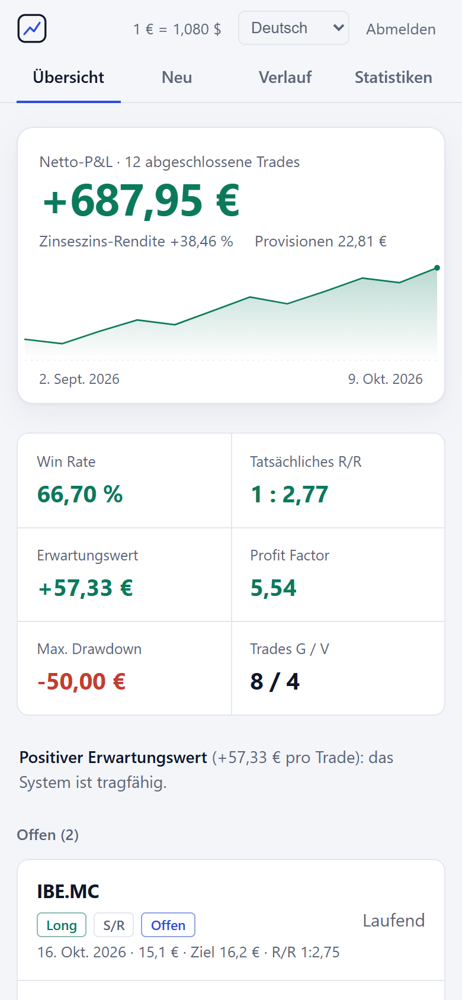

<div align="center">

# Trading Journal

**Ein selbst gehostetes Journal, um Trade-Entscheidungen festzuhalten und die Ergebnisse zu prüfen.**

[](https://github.com/nmc03/trading-journal/actions/workflows/ci.yml)
[](LICENSE)
[](https://nodejs.org/)

[English](README.md) · [Español](README.es.md) · [Français](README.fr.md) · **Deutsch** · [Português](README.pt.md)

</div>

<p align="center">
  
</p>

<p align="center"><sub>Die Demo und alle Screenshots verwenden synthetische Daten.</sub></p>

## Was es ist

Trading Journal ist eine Web-App für eine einzelne Person. Sie erfassen jeden Trade mit dem Einstiegsgrund, dem Plan, dem Stop und dem Ziel. Anschließend berechnet die App Ihre Ergebnisse und zeigt, welche Setups und Gewohnheiten sich auszahlen.

Ihre Daten bleiben in einer SQLite-Datenbank auf dem Rechner, der die App ausführt. Es gibt kein Cloud-Konto, kein Abo und keine Telemetrie.

**Geeignet für:**

- Einzelne Trader, die ein privates Protokoll auf dem eigenen Rechner oder im Heimnetz führen möchten.
- Prüfen, ob Sie sich an Ihren Plan gehalten haben, und wie sich das auf die Ergebnisse auswirkt.
- Eine lokale CSV- oder JSON-Kopie Ihrer Trades aufbewahren.

**Nicht geeignet für:**

- Mehrere Benutzer oder Teams, die sich ein Journal teilen.
- Automatischer Import von einem Broker. Es können nur CSV-Dateien importiert werden, die diese App exportiert hat.
- Steuerberichte oder Anlageberatung.

## Funktionen

- **Journal:** Long- und Short-Trades; Einstieg, Ausstieg, Stop, Ziel, Positionsgröße, Provisionen; EUR und USD mit einstellbarem EUR/USD-Kurs; Setup-Typ und ob der Plan eingehalten wurde.
- **Auswertung:** R/R-Vorschau vor dem Speichern; Win Rate, tatsächliches R/R, Erwartungswert, Profit Factor, maximaler Drawdown und kumulative P&L-Kurve; Aufschlüsselung nach Setup und nach Plandisziplin.
- **Daten:** Verlauf mit Suche und Filter offen/geschlossen; Löschen mit Bestätigung; CSV-Export (sicher gegen Tabellenkalkulations-Formeln); JSON-Export; CSV-Import von Dateien, die die App exportiert hat.
- **Oberfläche:** helles und dunkles Design, folgt der Systemeinstellung `prefers-color-scheme`; Layouts für Desktop und Mobilgerät; Oberfläche auf Spanisch, Englisch, Französisch, Deutsch und Portugiesisch. Die Sprache folgt dem Browser und lässt sich in der App ändern.
- **Selbst gehostet:** Node.js 24 oder Docker; Anmeldung mit 8-Stunden-JWTs; kein eingebautes HTTPS.

## Screenshots

| Helles Design | Dunkles Design |
| --- | --- |
|  |  |

| Verlauf | Statistiken | Neuer Trade |
| --- | --- | --- |
|  |  |  |

<p align="center">
  
</p>

## Schnellstart

Sie benötigen Node.js 24 oder Docker.

```bash
git clone https://github.com/nmc03/trading-journal.git
cd trading-journal
cp backend/.env.example backend/.env
```

Bearbeiten Sie `backend/.env` und ersetzen Sie die Beispielwerte:

- `TJ_PASSWORD`: Ihr Anmeldepasswort. Die App startet nicht mit dem Beispielwert.
- `JWT_SECRET`: eine zufällige Zeichenfolge mit mindestens 32 Zeichen. Erzeugen Sie eine mit `openssl rand -base64 48`.

### Option A: Node.js direkt

```bash
cd frontend
npm ci
npm run build
```

Das baut die Oberfläche nach `frontend/dist`. Starten Sie danach den Server aus `backend/`. Zwei Einstellungen legen fest, wo die Datenbank liegt (`DATA_DIR`) und welche gebaute Oberfläche ausgeliefert wird (`STATIC_DIR`). Beide Pfade sind relativ zu dem Ordner, aus dem Sie den Server starten.

```bash
cd ../backend
npm ci
DATA_DIR=../data STATIC_DIR=../frontend/dist node --env-file=.env server.js
```

Unter Windows PowerShell:

```powershell
cd ../backend
npm ci
$env:DATA_DIR = "../data"; $env:STATIC_DIR = "../frontend/dist"; node --env-file=.env server.js
```

Öffnen Sie <http://localhost:3001>.

> Übergeben Sie `DATA_DIR` und `STATIC_DIR` wie oben auf der Kommandozeile und fügen Sie sie nicht zu `backend/.env` hinzu. Docker liest dieselbe Datei und verwendet seine eigenen Standardwerte.

Für die Entwicklung mit Hot Reload lassen Sie das Backend laufen und führen `npm run dev` in `frontend/` aus. Vite liefert die Oberfläche unter <http://localhost:5173> aus und leitet `/api` an Port 3001 weiter.

### Option B: Docker

```bash
docker compose up -d --build
```

Öffnen Sie <http://localhost:8080>. Für einen anderen Host-Port in PowerShell: `$env:HTTP_PORT=8088; docker compose up -d`. In bash: `HTTP_PORT=8088 docker compose up -d`.

> **Sicherheitshinweis.** Die App hat kein eingebautes HTTPS. Verwenden Sie sie auf localhost, im lokalen Netz oder über ein VPN. Docker veröffentlicht den Port auf allen Schnittstellen. Ist die App aus einem nicht vertrauenswürdigen Netz erreichbar, stellen Sie einen HTTPS-Reverse-Proxy davor und setzen `TRUST_PROXY_HOPS=1`.

## Konfiguration

Setzen Sie diese Werte in `backend/.env`.

| Variable | Pflicht | Zweck |
| --- | --- | --- |
| `TJ_USER` | Ja | Benutzername für die Anmeldung |
| `TJ_PASSWORD` | Ja | Anmeldepasswort. Darf nicht der Beispielwert sein |
| `JWT_SECRET` | Ja | Zufälliges Secret, mindestens 32 Zeichen. Darf nicht der Beispielwert sein |
| `PORT` | Nein | API-Port. Standard `3001`. Mit Docker auf `3001` belassen |
| `DATA_DIR` | Nein | Ordner für `trading.db`. Standard `/app/data`, das verwendet Docker. Bei Option A `../data` auf der Kommandozeile übergeben |
| `STATIC_DIR` | Nein | Ordner mit der gebauten Oberfläche. Standard `backend/public`, dorthin legt das Docker-Image sie ab. Bei Option A `../frontend/dist` auf der Kommandozeile übergeben |
| `TRUST_PROXY_HOPS` | Nein | Anzahl der Reverse-Proxys vor der App. Standard `0`. Nur auf `1` setzen, wenn ein HTTPS-Reverse-Proxy wie Caddy oder Traefik davorsteht |
| `CORS_ORIGIN` | Nein | Kommagetrennte Ursprünge, die die API aufrufen dürfen, z. B. für ein Frontend auf einem anderen Ursprung. Standardmäßig aus |

Docker Compose liest außerdem `HTTP_PORT` (Standard `8080`) aus der Shell-Umgebung. Damit wird der Host-Port gesetzt.

## Backups, Wiederherstellung und Aktualisierung

Alle Journaldaten liegen in `data/trading.db`, im Ordner `data/`. Git ignoriert `data/` und `.env`-Dateien.

Stoppen Sie die App, bevor Sie die Daten kopieren. Die Datenbank nutzt den SQLite-WAL-Modus, daher kann eine Kopie, die während des Betriebs entsteht, unvollständig sein.

Backup mit Docker:

```bash
docker compose stop app
tar -czf trading-journal-data.tar.gz data/
docker compose start app
```

Wiederherstellung mit Docker:

```bash
docker compose stop app
mv data data.before-restore
tar -xzf trading-journal-data.tar.gz
docker compose start app
```

Löschen Sie `data.before-restore`, sobald die Wiederherstellung funktioniert. Bewahren Sie Backup-Archive außerhalb des Projektordners auf.

Bei Node.js beenden Sie den Server mit `Ctrl+C`, kopieren oder stellen den Ordner `data/` wieder her und starten den Server erneut.

Um eine Docker-Installation zu aktualisieren, sichern Sie zuerst `data/` und führen dann aus:

```bash
git pull
docker compose up -d --build
```

Ein Neubau entfernt den eingebundenen Ordner `data/` nicht.

Für einen dauerhaften Betrieb nutzen Sie Ihren üblichen Backup-Prozess auf Host-Ebene und bewahren Kopien auf einem anderen Rechner auf.

## Sprachen

Die Oberfläche wählt die Sprache in dieser Reihenfolge:

1. Die im Browser unter `tj_lang` gespeicherte Sprache, sofern sie gewählt wurde.
2. Die erste unterstützte Sprache in der Sprachliste des Browsers.
3. Spanisch, der Standard.

Die API verwendet den `Accept-Language`-Header, um die Sprache der Fehlermeldungen zu wählen.

Unterstützte Sprachen: Spanisch (`es`), Englisch (`en`), Französisch (`fr`), Deutsch (`de`) und Portugiesisch (`pt`).

Um eine Sprache hinzuzufügen:

1. Kopieren Sie `frontend/src/lib/locales/es.js` nach `frontend/src/lib/locales/xx.js` und übersetzen Sie die Werte. Die Schlüssel bleiben gleich.
2. Ergänzen Sie die API-Meldungen in `MESSAGES` in `backend/i18n.js` mit denselben Schlüsseln und `{variablen}` wie bei `es`.
3. Registrieren Sie die Sprache in `LANGS` in `frontend/src/lib/i18n.js` mit einem `label`, einem `locale` wie `en-GB` und dem importierten Wörterbuch.
4. Führen Sie `npm test` in `backend/` und in `frontend/` aus. Die Tests schlagen fehl, wenn ein Schlüssel oder eine `{variable}` fehlt.

## Metrik-Glossar

Kennzahlen verwenden nur abgeschlossene Trades: Trades mit Einstiegskurs, Ausstiegskurs und Positionsgröße. Beträge sind in EUR. Quelle: `frontend/src/lib/calc.js`.

- **P&L:** Long `(Ausstieg - Einstieg) x Stückzahl`; Short `(Einstieg - Ausstieg) x Stückzahl`; abzüglich Einstiegs- und Ausstiegsprovision. USD-Beträge werden durch den eingestellten EUR/USD-Kurs geteilt (Standard `1,08`).
- **Win Rate:** Trades mit P&L über null / abgeschlossene Trades x 100.
- **Tatsächliches R/R:** durchschnittlicher Gewinn / durchschnittlicher Verlust (als Absolutwerte).
- **Erwartungswert:** Gesamt-P&L / abgeschlossene Trades. Break-even-Trades zählen als null.
- **Profit Factor:** Bruttogewinn / Bruttoverlust. Wird als `∞` angezeigt, wenn es keine verlustbringenden Trades gibt.
- **Max. Drawdown:** größter Rückgang von einem Höchststand der kumulativen P&L-Kurve bis zu einem späteren Tief.
- **Kumulative P&L-Kurve:** laufende Summe der P&L jedes abgeschlossenen Trades, in Reihenfolge des Trade-Datums.
- **Zinseszins-Rendite:** Produkt aus `(1 + Trade-%)` über alle abgeschlossenen Trades, minus 1. Trade-% ist die Kursbewegung in Richtung des Trades, vor Provisionen.
- **Setup-Analyse** und **Plandisziplin:** die oben genannten Kennzahlen, gruppiert nach Setup-Typ oder danach, ob der Plan eingehalten wurde.

Die Zinseszins-Rendite ist eine theoretische Kette von Trade-Ergebnissen. Sie ist weder eine zeitgewichtete Rendite (TWR) noch eine geldgewichtete Rendite (MWR). Sie berücksichtigt keine Ein- und Auszahlungen, Positionsgrößen und Zeitpunkte und kann daher von der Angabe Ihres Brokers abweichen.

## Sicherheit und Datenschutz

- Passwörter werden mit bcrypt geprüft. Die App startet nicht mit dem Beispielpasswort oder mit einem `JWT_SECRET`, das kürzer als 32 Zeichen ist.
- Login-Token sind mit HS256 signierte JWTs und 8 Stunden gültig.
- Anmeldeversuche sind auf 10 pro 15 Minuten und Client begrenzt.
- Anfragen sind auf 100 KB begrenzt. Die API validiert jedes Feld. SQL-Abfragen sind parametrisiert.
- Helmet sendet Sicherheits-Header, darunter `Content-Security-Policy: default-src 'self'`. CORS ist deaktiviert, solange `CORS_ORIGIN` nicht gesetzt ist.
- Die App sendet keine Telemetrie, Analysedaten oder Anfragen an Dritte und setzt keine Cookies. Das Login-Token wird im `localStorage` des Browsers unter `tj_token` gespeichert.

Die App hat kein eingebautes TLS. Siehe [SECURITY.md](SECURITY.md) (auf Englisch) für unterstützte Versionen und das Melden einer Sicherheitslücke. Siehe [PRIVACY.md](PRIVACY.md) (auf Englisch) für Angaben dazu, was gespeichert wird und wo.

## Entwicklung

Backend:

```bash
cd backend
npm ci
npm test
npm run check
npm audit --omit=dev --audit-level=high
```

Frontend:

```bash
cd frontend
npm ci
npm test
npm run build
npm audit --audit-level=high
```

Die Berechnungslogik ist rein und enthält keinen React- oder DOM-Code: `frontend/src/lib/calc.js`. Ihre Tests stehen in `calc.test.js`.

Die CI führt die Backend- und Frontend-Prüfungen aus, validiert `docker-compose.yml` und baut das Docker-Image. Zum Neuerstellen der Screenshots und Demo-GIFs siehe [CONTRIBUTING.md](CONTRIBUTING.md#regenerating-screenshots-and-demo-gifs) (auf Englisch).

## FAQ

**Die App startet nicht. Woran liegt das?**
Prüfen Sie `backend/.env`. Das Beispielpasswort und das Beispiel-`JWT_SECRET` werden absichtlich abgelehnt. `JWT_SECRET` muss mindestens 32 Zeichen lang sein.

**Kann ich es vom Handy oder von einem anderen Computer aus nutzen?**
Ja, sofern der Rechner, auf dem das Journal läuft, in Ihrem Netz erreichbar ist. Die App liefert unverschlüsseltes HTTP aus. Stellen Sie sie außerhalb des eigenen Netzes nur hinter einem HTTPS-Reverse-Proxy bereit.

**Warum weicht meine Zinseszins-Rendite von der Rendite meines Brokers ab?**
Das Journal verkettet das prozentuale Ergebnis jedes abgeschlossenen Trades. Ein- und Auszahlungen sowie Positionsgrößen werden nicht berücksichtigt. Siehe das [Metrik-Glossar](#metrik-glossar).

## Mitwirken

Gezielte Fehlerbehebungen und Verbesserungen sind willkommen. Lesen Sie [CONTRIBUTING.md](CONTRIBUTING.md) (auf Englisch), bevor Sie einen Pull Request eröffnen. Dies ist ein persönliches Projekt und kein kommerzielles Produkt.

## Haftungsausschluss

Trading Journal ist ein Werkzeug zur Dokumentation und Analyse. Es bietet keine Anlageberatung, keine Brokerdienste und keine Garantien für Handelsergebnisse.

## Lizenz

Veröffentlicht unter der [MIT-Lizenz](LICENSE).
