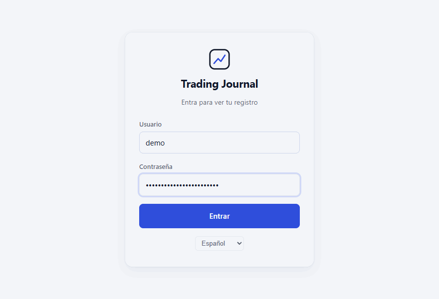
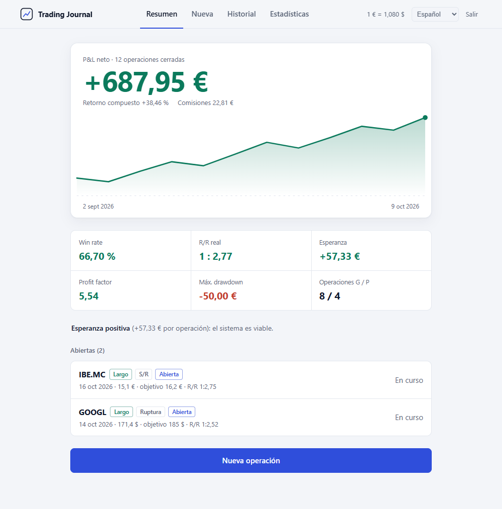
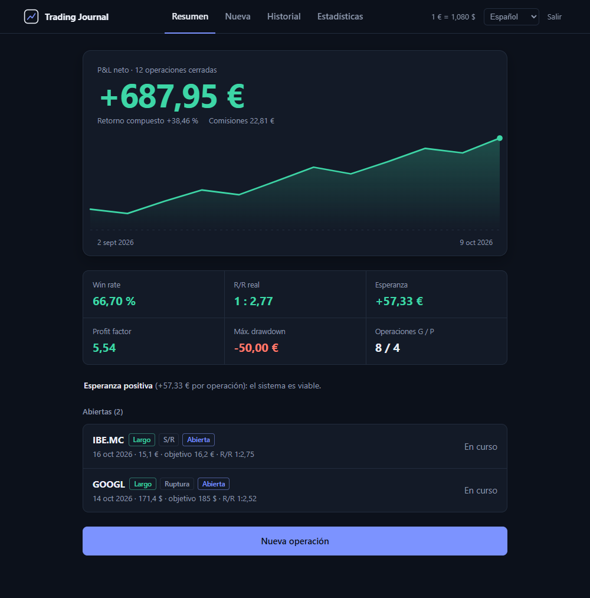
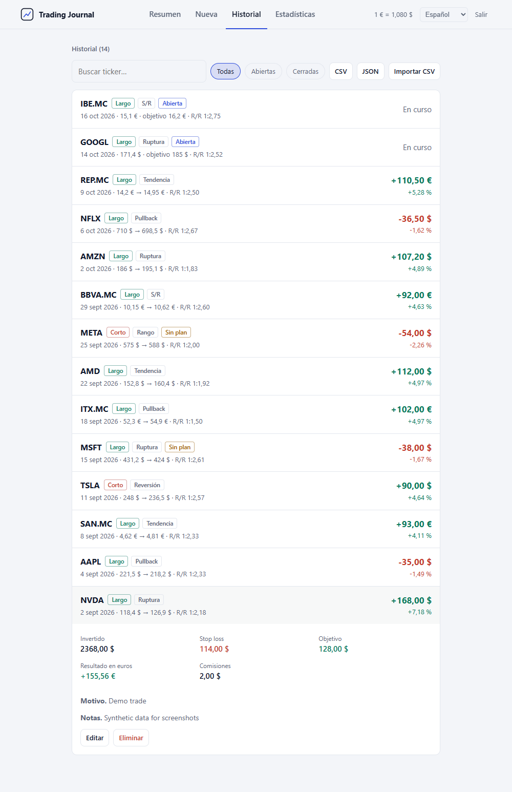
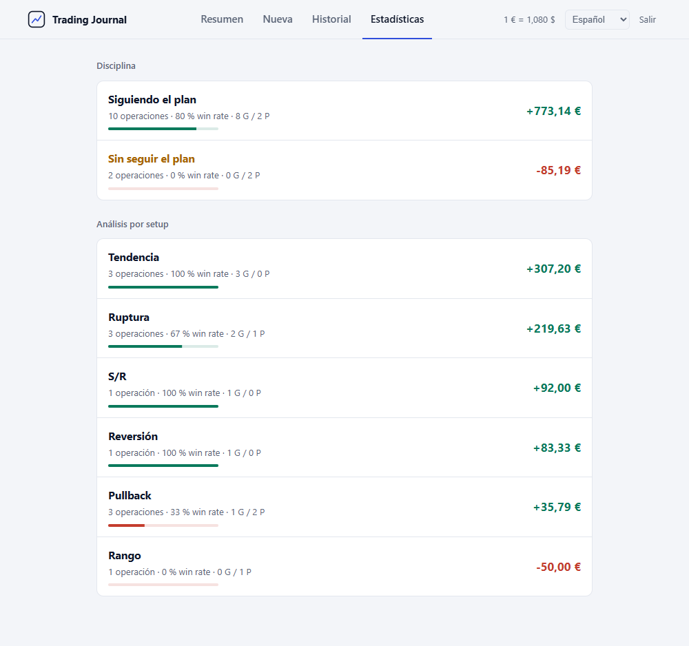
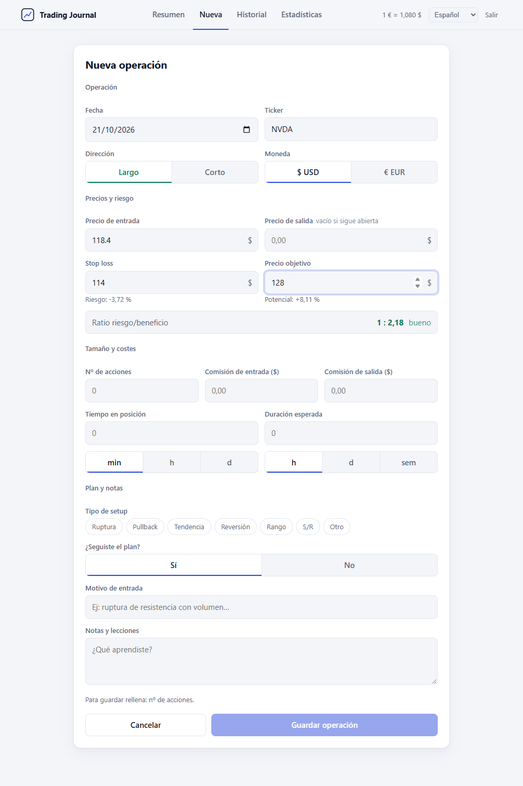
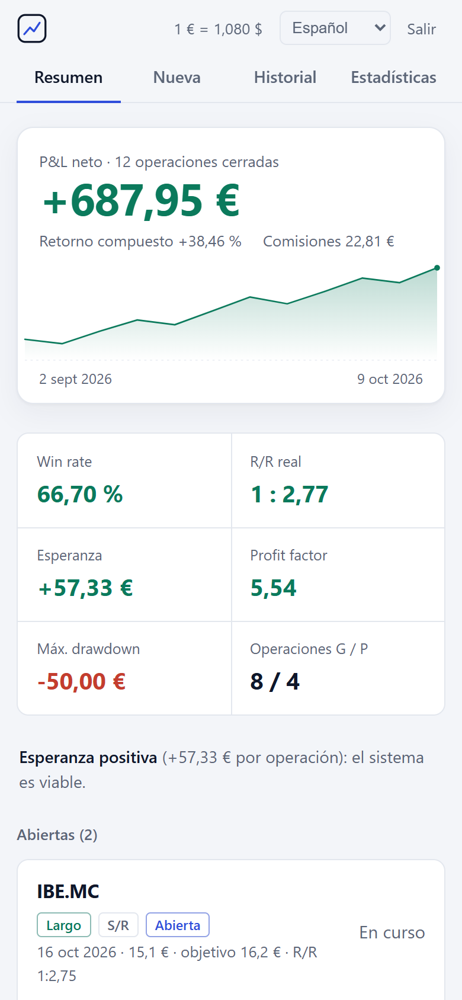

<div align="center">

# Trading Journal

**Un diario autoalojado para registrar las decisiones de trading y revisar los resultados.**

[](https://github.com/nmc03/trading-journal/actions/workflows/ci.yml)
[](LICENSE)
[](https://nodejs.org/)

[English](README.md) · **Español** · [Français](README.fr.md) · [Deutsch](README.de.md) · [Português](README.pt.md)

</div>

<p align="center">
  
</p>

<p align="center"><sub>La demo y todas las capturas usan datos sintéticos.</sub></p>

## Qué es

Trading Journal es una aplicación web para un solo usuario. Registras cada operación con el motivo de entrada, el plan, el stop y el objetivo. Después calcula tus resultados y muestra qué setups y qué hábitos te dan resultados.

Tus datos se quedan en una base de datos SQLite en la máquina que ejecuta la app. No hay cuenta en la nube, ni suscripción, ni telemetría.

**Indicado para:**

- Un trader particular que quiere un registro privado en su propio equipo o en su red doméstica.
- Revisar si seguiste el plan y cómo afecta eso a los resultados.
- Guardar una copia local en CSV o JSON de tus operaciones.

**No indicado para:**

- Varios usuarios o equipos que comparten un mismo diario.
- Importación automática desde un bróker. Solo se pueden importar archivos CSV exportados por esta app.
- Informes fiscales o asesoramiento de inversión.

## Características

- **Diario:** operaciones largas y cortas; entrada, salida, stop, objetivo, tamaño de posición y comisiones; EUR y USD con un tipo de cambio EUR/USD configurable; tipo de setup y si se siguió el plan.
- **Revisión:** vista previa de riesgo/beneficio antes de guardar; win rate, R/R real, esperanza, profit factor, máximo drawdown y curva de P&L acumulado; desglose por setup y por disciplina en el plan.
- **Datos:** historial con búsqueda y filtro de abiertas/cerradas; borrado con confirmación; exportación CSV (segura frente a fórmulas de hoja de cálculo); exportación JSON; importación CSV de los archivos exportados por la app.
- **Interfaz:** temas claro y oscuro, según la preferencia `prefers-color-scheme` del sistema; diseños para escritorio y móvil; interfaz en español, inglés, francés, alemán y portugués. El idioma sigue al navegador y se puede cambiar en la app.
- **Autoalojamiento:** Node.js 24 o Docker; inicio de sesión con JWT de 8 horas; sin HTTPS integrado.

## Capturas de pantalla

| Tema claro | Tema oscuro |
| --- | --- |
|  |  |

| Historial | Estadísticas | Nueva operación |
| --- | --- | --- |
|  |  |  |

<p align="center">
  
</p>

## Inicio rápido

Necesitas Node.js 24 o Docker.

```bash
git clone https://github.com/nmc03/trading-journal.git
cd trading-journal
cp backend/.env.example backend/.env
```

Edita `backend/.env` y sustituye los valores de ejemplo:

- `TJ_PASSWORD`: tu contraseña de acceso. La app no arranca con el valor de ejemplo.
- `JWT_SECRET`: una cadena aleatoria de al menos 32 caracteres. Genera una con `openssl rand -base64 48`.

### Opción A: Node.js directamente

```bash
cd frontend
npm ci
npm run build
```

Esto compila la interfaz en `frontend/dist`. Después arranca el servidor desde `backend/`. Dos ajustes indican dónde guardar la base de datos (`DATA_DIR`) y qué interfaz compilada servir (`STATIC_DIR`). Las dos rutas son relativas a la carpeta desde la que arrancas el servidor.

```bash
cd ../backend
npm ci
DATA_DIR=../data STATIC_DIR=../frontend/dist node --env-file=.env server.js
```

En PowerShell de Windows:

```powershell
cd ../backend
npm ci
$env:DATA_DIR = "../data"; $env:STATIC_DIR = "../frontend/dist"; node --env-file=.env server.js
```

Abre <http://localhost:3001>.

> Pasa `DATA_DIR` y `STATIC_DIR` en la línea de comandos, como se indica arriba, y no los añadas a `backend/.env`. Docker lee ese mismo archivo y espera sus propios valores por defecto.

Para desarrollar con recarga en caliente, deja el backend en marcha y ejecuta `npm run dev` en `frontend/`. Vite sirve la interfaz en <http://localhost:5173> y redirige `/api` al puerto 3001.

### Opción B: Docker

```bash
docker compose up -d --build
```

Abre <http://localhost:8080>. Para usar otro puerto del host en PowerShell, ejecuta `$env:HTTP_PORT=8088; docker compose up -d`. En bash, ejecuta `HTTP_PORT=8088 docker compose up -d`.

> **Aviso de seguridad.** La app no incluye HTTPS. Úsala en localhost, en tu red local o a través de una VPN. Docker publica el puerto en todas las interfaces. Si la app es accesible desde una red no fiable, ponla detrás de un proxy inverso HTTPS y define `TRUST_PROXY_HOPS=1`.

## Configuración

Define estas variables en `backend/.env`.

| Variable | Obligatoria | Función |
| --- | --- | --- |
| `TJ_USER` | Sí | Nombre de usuario para acceder |
| `TJ_PASSWORD` | Sí | Contraseña de acceso. No puede ser el valor de ejemplo |
| `JWT_SECRET` | Sí | Secreto aleatorio, de al menos 32 caracteres. No puede ser el valor de ejemplo |
| `PORT` | No | Puerto de la API. Por defecto `3001`. Déjalo en `3001` con Docker |
| `DATA_DIR` | No | Carpeta de `trading.db`. Por defecto `/app/data`, que es lo que usa Docker. En la opción A, pasa `../data` en la línea de comandos |
| `STATIC_DIR` | No | Carpeta con la interfaz compilada. Por defecto `backend/public`, donde la imagen de Docker la coloca. En la opción A, pasa `../frontend/dist` en la línea de comandos |
| `TRUST_PROXY_HOPS` | No | Número de proxies inversos delante de la app. Por defecto `0`. Usa `1` solo detrás de un proxy inverso HTTPS como Caddy o Traefik |
| `CORS_ORIGIN` | No | Orígenes separados por comas que pueden llamar a la API, para un frontend en otro origen. Desactivado por defecto |

Docker Compose también lee `HTTP_PORT` (por defecto `8080`) del entorno de la shell. Define el puerto del host.

## Copias de seguridad, restauración y actualización

Todos los datos del diario están en `data/trading.db`, dentro de la carpeta `data/`. Git ignora `data/` y los archivos `.env`.

Detén la app antes de copiar los datos. La base de datos usa el modo WAL de SQLite, así que una copia hecha con la app en marcha puede quedar incompleta.

Copia de seguridad con Docker:

```bash
docker compose stop app
tar -czf trading-journal-data.tar.gz data/
docker compose start app
```

Restauración con Docker:

```bash
docker compose stop app
mv data data.before-restore
tar -xzf trading-journal-data.tar.gz
docker compose start app
```

Borra `data.before-restore` cuando compruebes que la restauración funciona. Guarda las copias de seguridad fuera de la carpeta del proyecto.

En Node.js, detén el servidor con `Ctrl+C`, copia o restaura la carpeta `data/` y vuelve a arrancar el servidor.

Para actualizar una instalación con Docker, haz primero una copia de `data/` y después ejecuta:

```bash
git pull
docker compose up -d --build
```

Reconstruir la imagen no elimina la carpeta `data/` montada.

Si la app funciona de forma permanente, usa el sistema de copias habitual de tu equipo y guarda las copias en otra máquina.

## Idiomas

La interfaz elige el idioma en este orden:

1. El idioma guardado en el navegador con la clave `tj_lang`, si el usuario lo eligió.
2. El primer idioma soportado de la lista de idiomas del navegador.
3. Español, por defecto.

La API usa la cabecera `Accept-Language` para elegir el idioma de los mensajes de error.

Idiomas soportados: español (`es`), inglés (`en`), francés (`fr`), alemán (`de`) y portugués (`pt`).

Para añadir un idioma:

1. Copia `frontend/src/lib/locales/es.js` a `frontend/src/lib/locales/xx.js` y traduce los valores. Mantén las mismas claves.
2. Añade los mensajes de la API a `MESSAGES` en `backend/i18n.js`, con las mismas claves y `{variables}` que `es`.
3. Registra el idioma en `LANGS` de `frontend/src/lib/i18n.js`, con un `label`, un `locale` como `en-GB` y el diccionario importado.
4. Ejecuta `npm test` en `backend/` y en `frontend/`. Las pruebas fallan si falta una clave o una `{variable}`.

## Glosario de métricas

Las métricas usan solo operaciones cerradas: las que tienen precio de entrada, precio de salida y tamaño de posición. Los importes están en EUR. Fuente: `frontend/src/lib/calc.js`.

- **P&L:** en largas, `(salida - entrada) x acciones`; en cortas, `(entrada - salida) x acciones`; menos las comisiones de entrada y salida. Los importes en USD se dividen entre el tipo EUR/USD que configuras (por defecto `1,08`).
- **Win rate:** operaciones con P&L mayor que cero / operaciones cerradas x 100.
- **R/R real:** P&L medio de las operaciones ganadoras / P&L medio de las perdedoras (en valor absoluto).
- **Esperanza:** P&L total / operaciones cerradas. Las operaciones en punto de equilibrio cuentan como cero.
- **Profit factor:** beneficio bruto / pérdida bruta. Se muestra como `∞` cuando no hay operaciones perdedoras.
- **Máximo drawdown:** mayor caída desde un pico hasta un mínimo posterior en la curva de P&L acumulado.
- **Curva de P&L acumulado:** suma acumulada del P&L de cada operación cerrada, en orden de fecha.
- **Retorno compuesto:** producto de `(1 + % de la operación)` sobre todas las operaciones cerradas, menos 1. El % de la operación es el movimiento del precio en la dirección de la operación, antes de comisiones.
- **Análisis por setup** y **disciplina en el plan:** las métricas anteriores agrupadas por tipo de setup o según si se siguió el plan.

El retorno compuesto es una cadena teórica de resultados de operaciones. No es un TWR (rentabilidad ponderada por tiempo) ni un MWR (rentabilidad ponderada por dinero). Ignora los depósitos, las retiradas, el tamaño de las posiciones y el momento de cada operación, así que puede diferir de la cifra de tu bróker.

## Seguridad y privacidad

- Las contraseñas se comprueban con bcrypt. La app no arranca con la contraseña de ejemplo ni con un `JWT_SECRET` de menos de 32 caracteres.
- Los tokens de acceso son JWT firmados con HS256 y válidos durante 8 horas.
- Los intentos de acceso están limitados a 10 cada 15 minutos por cliente.
- Los cuerpos de petición están limitados a 100 KB. La API valida cada campo. Las consultas SQL son parametrizadas.
- Helmet envía cabeceras de seguridad, incluida `Content-Security-Policy: default-src 'self'`. CORS está desactivado salvo que se defina `CORS_ORIGIN`.
- La app no envía telemetría, analítica ni peticiones a terceros, y no establece cookies. El token de acceso se guarda en el `localStorage` del navegador con la clave `tj_token`.

La app no incluye TLS. Consulta [SECURITY.md](SECURITY.md) (en inglés) para ver las versiones soportadas y cómo notificar una vulnerabilidad. Consulta [PRIVACY.md](PRIVACY.md) (en inglés) para saber qué se guarda y dónde.

## Desarrollo

Backend:

```bash
cd backend
npm ci
npm test
npm run check
npm audit --omit=dev --audit-level=high
```

Frontend:

```bash
cd frontend
npm ci
npm test
npm run build
npm audit --audit-level=high
```

El código de cálculo es puro y no contiene código de React ni del DOM: `frontend/src/lib/calc.js`. Sus pruebas están en `calc.test.js`.

El CI ejecuta las comprobaciones de backend y frontend, valida `docker-compose.yml` y construye la imagen de Docker. Para regenerar las capturas y los GIF de demo, consulta [CONTRIBUTING.md](CONTRIBUTING.md#regenerating-screenshots-and-demo-gifs) (en inglés).

## Preguntas frecuentes

**La app no arranca. ¿Por qué?**
Revisa `backend/.env`. La contraseña de ejemplo y el `JWT_SECRET` de ejemplo se rechazan a propósito. `JWT_SECRET` debe tener al menos 32 caracteres.

**¿Puedo usarla desde el móvil u otro ordenador?**
Sí, si la máquina que ejecuta el diario es accesible en tu red. La app sirve HTTP sin cifrar: para usarla fuera de tu propia red, ponla detrás de un proxy inverso HTTPS.

**¿Por qué mi retorno compuesto no coincide con el de mi bróker?**
El diario encadena el resultado porcentual de cada operación cerrada. No tiene en cuenta los depósitos, las retiradas ni el tamaño de la posición. Consulta el [Glosario de métricas](#glosario-de-métricas).

## Contribuir

Se agradecen las correcciones y mejoras acotadas. Lee [CONTRIBUTING.md](CONTRIBUTING.md) (en inglés) antes de abrir un pull request. Es un proyecto personal, no un producto comercial.

## Aviso legal

Trading Journal es una herramienta de registro y análisis. No ofrece asesoramiento de inversión, servicios de bróker ni garantías sobre los resultados de la operativa.

## Licencia

Publicado bajo la [Licencia MIT](LICENSE).
