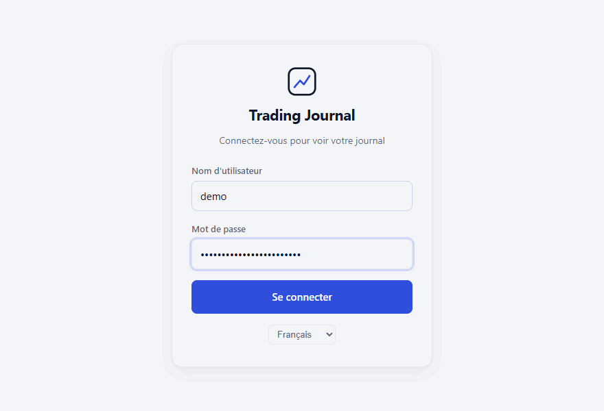
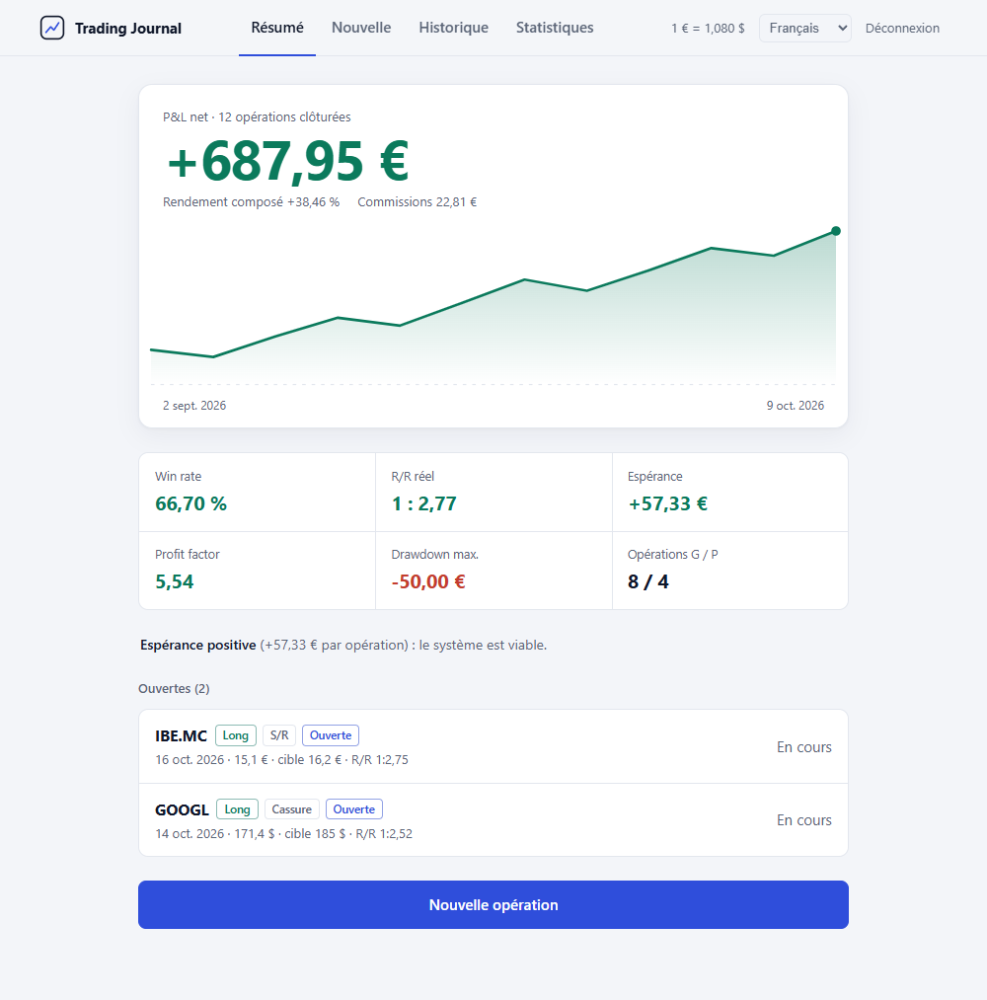
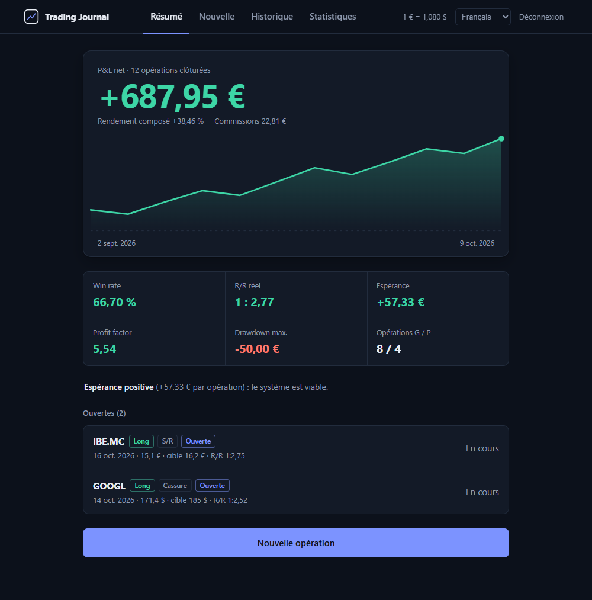
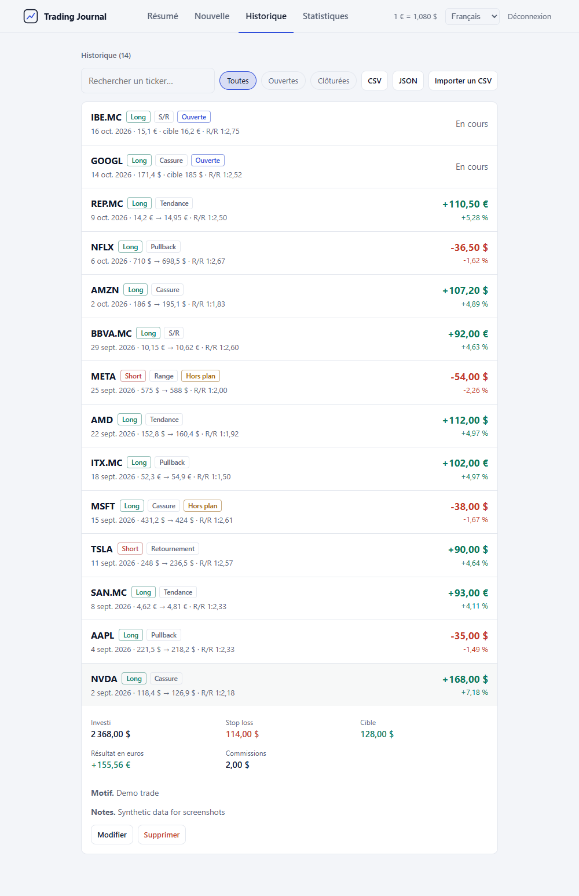
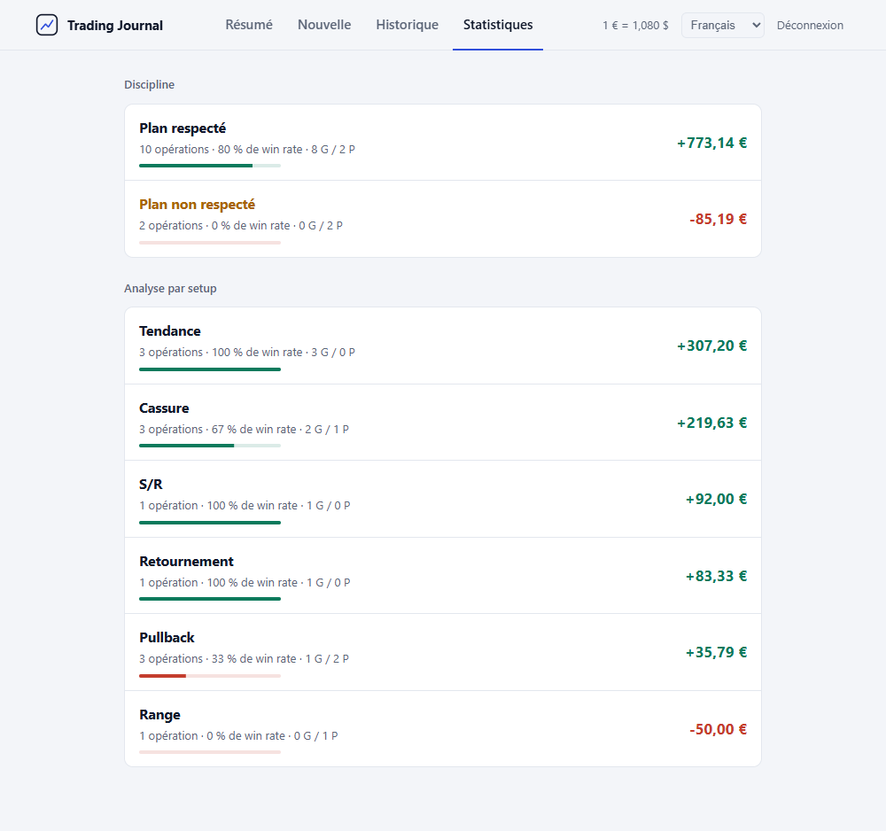
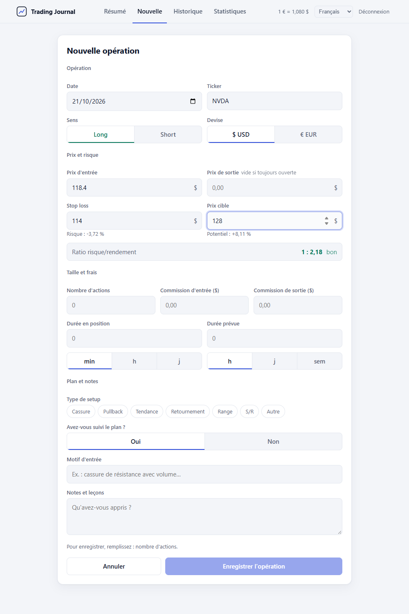
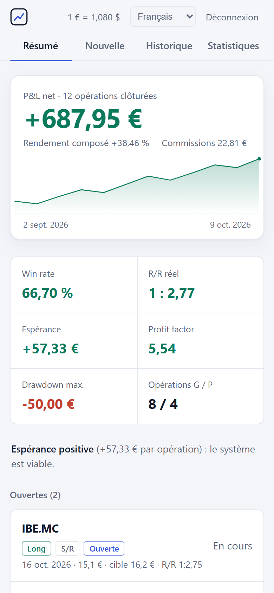

<div align="center">

# Trading Journal

**Un journal de trading auto-hébergé, pour consigner vos décisions et analyser les résultats.**

[](https://github.com/nmc03/trading-journal/actions/workflows/ci.yml)
[](LICENSE)
[](https://nodejs.org/)

[English](README.md) · [Español](README.es.md) · **Français** · [Deutsch](README.de.md) · [Português](README.pt.md)

</div>

<p align="center">
  
</p>

<p align="center"><sub>La démo et toutes les captures utilisent des données synthétiques.</sub></p>

## Présentation

Trading Journal est une application web mono-utilisateur. Vous consignez chaque trade avec le motif d'entrée, le plan, le stop et l'objectif. L'application calcule ensuite vos résultats et montre quels setups et quelles habitudes sont rentables.

Vos données restent dans une base SQLite, sur la machine qui exécute l'application. Il n'y a ni compte cloud, ni abonnement, ni télémétrie.

**Convient à :**

- Un trader individuel qui veut un journal privé, sur sa propre machine ou son réseau domestique.
- Vérifier si vous avez respecté votre plan, et quel effet cela a sur les résultats.
- Conserver une copie locale de vos trades en CSV ou en JSON.

**Ne convient pas à :**

- Plusieurs utilisateurs ou équipes qui partagent un même journal.
- L'import automatique depuis un courtier. Seuls les fichiers CSV exportés par cette application peuvent être importés.
- La déclaration fiscale ou les conseils en investissement.

## Fonctionnalités

- **Journal :** trades longs et courts ; entrée, sortie, stop, objectif, taille de position, commissions ; EUR et USD avec un taux EUR/USD configurable ; type de setup et respect du plan.
- **Analyse :** aperçu du ratio risque/rendement avant l'enregistrement ; win rate, R/R réel, espérance, profit factor, drawdown maximal et courbe du P&L cumulé ; répartition par setup et par respect du plan.
- **Données :** historique avec recherche et filtre ouvertes/clôturées ; suppression avec confirmation ; export CSV (protégé contre les formules de tableur) ; export JSON ; import CSV des fichiers exportés par l'application.
- **Interface :** thèmes clair et sombre, selon le réglage système `prefers-color-scheme` ; mise en page pour ordinateur et mobile ; interface en espagnol, anglais, français, allemand et portugais. La langue suit celle du navigateur et peut être changée dans l'application.
- **Auto-hébergement :** Node.js 24 ou Docker ; connexion par JWT valables 8 heures ; pas de HTTPS intégré.

## Captures d'écran

| Thème clair | Thème sombre |
| --- | --- |
|  |  |

| Historique | Statistiques | Nouvelle opération |
| --- | --- | --- |
|  |  |  |

<p align="center">
  
</p>

## Démarrage rapide

Il vous faut Node.js 24 ou Docker.

```bash
git clone https://github.com/nmc03/trading-journal.git
cd trading-journal
cp backend/.env.example backend/.env
```

Modifiez `backend/.env` et remplacez les valeurs d'exemple :

- `TJ_PASSWORD` : votre mot de passe de connexion. L'application refuse de démarrer avec la valeur d'exemple.
- `JWT_SECRET` : une chaîne aléatoire d'au moins 32 caractères. Générez-la avec `openssl rand -base64 48`.

### Option A : Node.js seul

```bash
cd frontend
npm ci
npm run build
```

Cette étape compile l'interface dans `frontend/dist`. Lancez ensuite le serveur depuis `backend/`. Deux réglages indiquent où conserver la base (`DATA_DIR`) et quelle interface compilée servir (`STATIC_DIR`). Les deux chemins sont relatifs au dossier depuis lequel vous lancez le serveur.

```bash
cd ../backend
npm ci
DATA_DIR=../data STATIC_DIR=../frontend/dist node --env-file=.env server.js
```

Sous Windows PowerShell :

```powershell
cd ../backend
npm ci
$env:DATA_DIR = "../data"; $env:STATIC_DIR = "../frontend/dist"; node --env-file=.env server.js
```

Ouvrez <http://localhost:3001>.

> Passez `DATA_DIR` et `STATIC_DIR` en ligne de commande, comme ci-dessus, sans les ajouter à `backend/.env`. Docker lit ce même fichier et utilise ses propres valeurs par défaut.

Pour le développement avec rechargement à chaud, gardez le backend lancé et exécutez `npm run dev` dans `frontend/`. Vite sert l'interface sur <http://localhost:5173> et redirige `/api` vers le port 3001.

### Option B : Docker

```bash
docker compose up -d --build
```

Ouvrez <http://localhost:8080>. Pour utiliser un autre port de l'hôte dans PowerShell, exécutez `$env:HTTP_PORT=8088; docker compose up -d`. Dans bash, exécutez `HTTP_PORT=8088 docker compose up -d`.

> **Avis de sécurité.** L'application n'intègre pas de HTTPS. Utilisez-la en localhost, sur votre réseau local ou via un VPN. Docker publie le port sur toutes les interfaces. Si l'application est accessible depuis un réseau non fiable, placez devant elle un reverse proxy HTTPS et définissez `TRUST_PROXY_HOPS=1`.

## Configuration

Définissez ces variables dans `backend/.env`.

| Variable | Obligatoire | Rôle |
| --- | --- | --- |
| `TJ_USER` | Oui | Identifiant de connexion |
| `TJ_PASSWORD` | Oui | Mot de passe de connexion. Ne doit pas être la valeur d'exemple |
| `JWT_SECRET` | Oui | Secret aléatoire d'au moins 32 caractères. Ne doit pas être la valeur d'exemple |
| `PORT` | Non | Port de l'API ; par défaut `3001`. Laissez `3001` avec Docker |
| `DATA_DIR` | Non | Dossier de `trading.db`. Par défaut `/app/data`, utilisé par Docker. Pour l'option A, passez `../data` en ligne de commande |
| `STATIC_DIR` | Non | Dossier de l'interface compilée. Par défaut `backend/public`, où l'image Docker la place. Pour l'option A, passez `../frontend/dist` en ligne de commande |
| `TRUST_PROXY_HOPS` | Non | Nombre de reverse proxies devant l'application. Par défaut `0`. Utilisez `1` uniquement derrière un reverse proxy HTTPS comme Caddy ou Traefik |
| `CORS_ORIGIN` | Non | Origines autorisées à appeler l'API, séparées par des virgules, pour un frontend sur une autre origine. Désactivé par défaut |

Docker Compose lit aussi `HTTP_PORT` (par défaut `8080`) dans l'environnement du shell. Il définit le port de l'hôte.

## Sauvegardes, restauration et mise à jour

Toutes les données du journal se trouvent dans `data/trading.db`, dans le dossier `data/`. Git ignore `data/` et les fichiers `.env`.

Arrêtez l'application avant de copier les données. La base utilise le mode WAL de SQLite : une copie faite pendant que l'application tourne peut être incomplète.

Sauvegarde avec Docker :

```bash
docker compose stop app
tar -czf trading-journal-data.tar.gz data/
docker compose start app
```

Restauration avec Docker :

```bash
docker compose stop app
mv data data.before-restore
tar -xzf trading-journal-data.tar.gz
docker compose start app
```

Supprimez `data.before-restore` une fois la restauration vérifiée. Conservez les archives de sauvegarde hors du dossier du projet.

Avec Node.js, arrêtez le serveur avec `Ctrl+C`, copiez ou restaurez le dossier `data/`, puis relancez le serveur.

Pour mettre à jour un déploiement Docker, sauvegardez d'abord `data/`, puis exécutez :

```bash
git pull
docker compose up -d --build
```

La reconstruction ne supprime pas le dossier `data/` monté.

Pour un déploiement de longue durée, utilisez votre processus de sauvegarde habituel au niveau de l'hôte et stockez des copies sur une autre machine.

## Langues

L'interface choisit sa langue dans cet ordre :

1. La langue enregistrée dans le navigateur sous `tj_lang`, si l'utilisateur en a choisi une.
2. La première langue prise en charge dans la liste des langues du navigateur.
3. L'espagnol, langue par défaut.

L'API utilise l'en-tête `Accept-Language` pour choisir la langue des messages d'erreur.

Langues prises en charge : espagnol (`es`), anglais (`en`), français (`fr`), allemand (`de`) et portugais (`pt`).

Pour ajouter une langue :

1. Copiez `frontend/src/lib/locales/es.js` vers `frontend/src/lib/locales/xx.js` et traduisez les valeurs. Gardez les mêmes clés.
2. Ajoutez les messages de l'API à `MESSAGES` dans `backend/i18n.js`, avec les mêmes clés et les mêmes `{variables}` que `es`.
3. Enregistrez la langue dans `LANGS` de `frontend/src/lib/i18n.js`, avec un `label`, un `locale` comme `en-GB` et le dictionnaire importé.
4. Exécutez `npm test` dans `backend/` et dans `frontend/`. Les tests échouent si une clé ou une `{variable}` manque.

## Glossaire des métriques

Les métriques ne portent que sur les trades clôturés : trades ayant un prix d'entrée, un prix de sortie et une taille de position. Les montants sont en EUR. Source : `frontend/src/lib/calc.js`.

- **P&L :** longs `(sortie - entrée) x titres` ; shorts `(entrée - sortie) x titres` ; moins les commissions d'entrée et de sortie. Les montants en USD sont divisés par le taux EUR/USD défini (par défaut `1,08`).
- **Win rate :** trades dont le P&L est supérieur à zéro / trades clôturés x 100.
- **R/R réel :** gain moyen / perte moyenne (valeurs absolues).
- **Espérance :** P&L total / trades clôturés. Les trades à l'équilibre (ni gain ni perte) comptent pour zéro.
- **Profit factor :** profit brut / perte brute. Affiché comme `∞` lorsqu'il n'y a aucun trade perdant.
- **Drawdown maximal :** plus forte baisse depuis un sommet jusqu'à un creux ultérieur, sur la courbe du P&L cumulé.
- **Courbe du P&L cumulé :** somme progressive du P&L de chaque trade clôturé, dans l'ordre des dates.
- **Rendement composé :** produit des `(1 + % du trade)` sur tous les trades clôturés, moins 1. Le % du trade est le mouvement de prix dans le sens du trade, avant commissions.
- **Analyse par setup** et **respect du plan :** les métriques ci-dessus, regroupées par type de setup ou selon que le plan a été suivi.

Le rendement composé est une chaîne théorique de résultats de trades. Ce n'est ni un TWR ni un MWR (rendements pondérés par le temps ou par les capitaux). Il ignore les dépôts, les retraits, la taille de position et le calendrier, et peut donc différer du chiffre de votre courtier.

## Sécurité et confidentialité

- Les mots de passe sont vérifiés avec bcrypt. L'application refuse de démarrer avec le mot de passe d'exemple ou un `JWT_SECRET` de moins de 32 caractères.
- Les jetons de connexion sont des JWT signés en HS256, valables 8 heures.
- Les tentatives de connexion sont limitées à 10 par période de 15 minutes et par client.
- Les corps de requête sont limités à 100 Ko. L'API valide chaque champ. Les requêtes SQL sont paramétrées.
- Helmet envoie des en-têtes de sécurité, dont `Content-Security-Policy: default-src 'self'`. Le CORS est désactivé tant que `CORS_ORIGIN` n'est pas défini.
- L'application n'envoie aucune télémétrie, aucune statistique ni requête tierce, et ne dépose aucun cookie. Le jeton de connexion est conservé dans le `localStorage` du navigateur, sous `tj_token`.

L'application n'intègre pas de TLS. Consultez [SECURITY.md](SECURITY.md) (en anglais) pour les versions prises en charge et la procédure de signalement d'une vulnérabilité. Consultez [PRIVACY.md](PRIVACY.md) (en anglais) pour savoir quelles données sont stockées et où.

## Développement

Backend :

```bash
cd backend
npm ci
npm test
npm run check
npm audit --omit=dev --audit-level=high
```

Frontend :

```bash
cd frontend
npm ci
npm test
npm run build
npm audit --audit-level=high
```

La logique de calcul est pure : elle ne contient ni code React ni code DOM (`frontend/src/lib/calc.js`). Ses tests se trouvent dans `calc.test.js`.

La CI exécute les vérifications du backend et du frontend, valide `docker-compose.yml` et construit l'image Docker. Pour régénérer les captures et les GIF de démonstration, consultez [CONTRIBUTING.md](CONTRIBUTING.md#regenerating-screenshots-and-demo-gifs) (en anglais).

## FAQ

**L'application refuse de démarrer. Pourquoi ?**
Vérifiez `backend/.env`. Le mot de passe d'exemple et le `JWT_SECRET` d'exemple sont rejetés volontairement. `JWT_SECRET` doit contenir au moins 32 caractères.

**Puis-je l'utiliser depuis mon téléphone ou un autre ordinateur ?**
Oui, si la machine qui exécute le journal est accessible sur votre réseau. L'application sert du HTTP non chiffré : ne l'exposez au-delà de votre réseau qu'à travers un reverse proxy HTTPS.

**Pourquoi mon rendement composé diffère-t-il de celui de mon courtier ?**
Le journal enchaîne le résultat en pourcentage de chaque trade clôturé. Il ne tient compte ni des dépôts, ni des retraits, ni de la taille de position. Voir le [glossaire des métriques](#glossaire-des-métriques).

## Contribution

Les corrections et améliorations ciblées sont les bienvenues. Lisez [CONTRIBUTING.md](CONTRIBUTING.md) (en anglais) avant d'ouvrir une pull request. Il s'agit d'un projet personnel, et non d'un produit commercial.

## Avertissement

Trading Journal est un outil de suivi et d'analyse. Il ne fournit ni conseil en investissement, ni services de courtage, ni garantie sur les résultats de trading.

## Licence

Publié sous [licence MIT](LICENSE).
