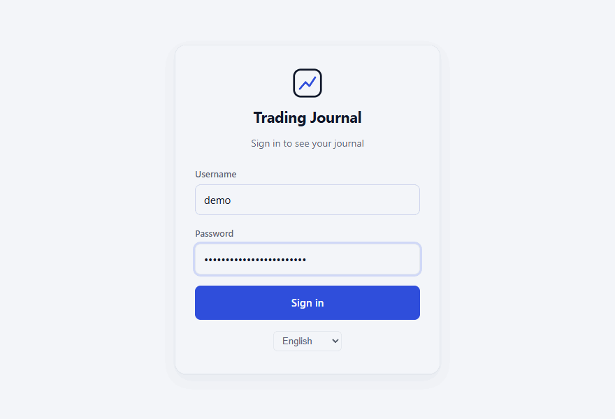
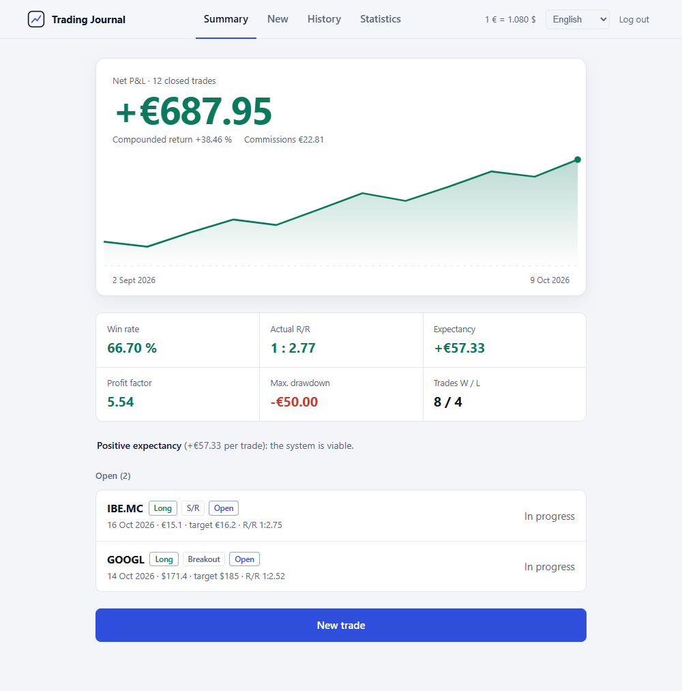
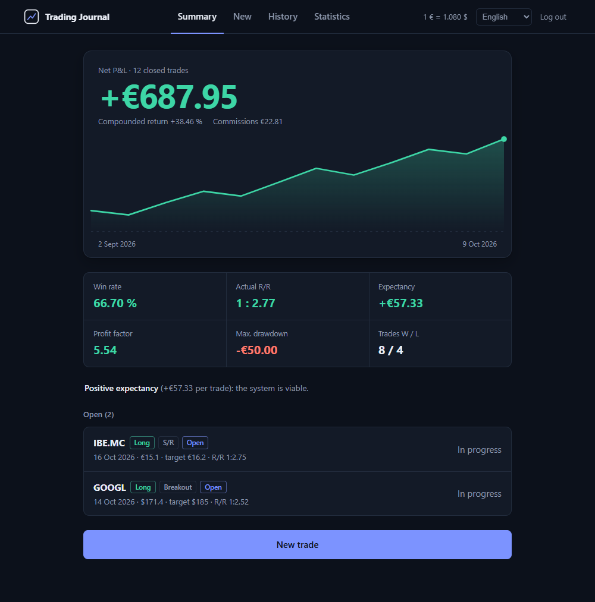
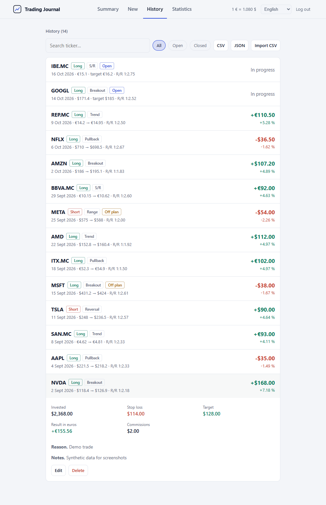
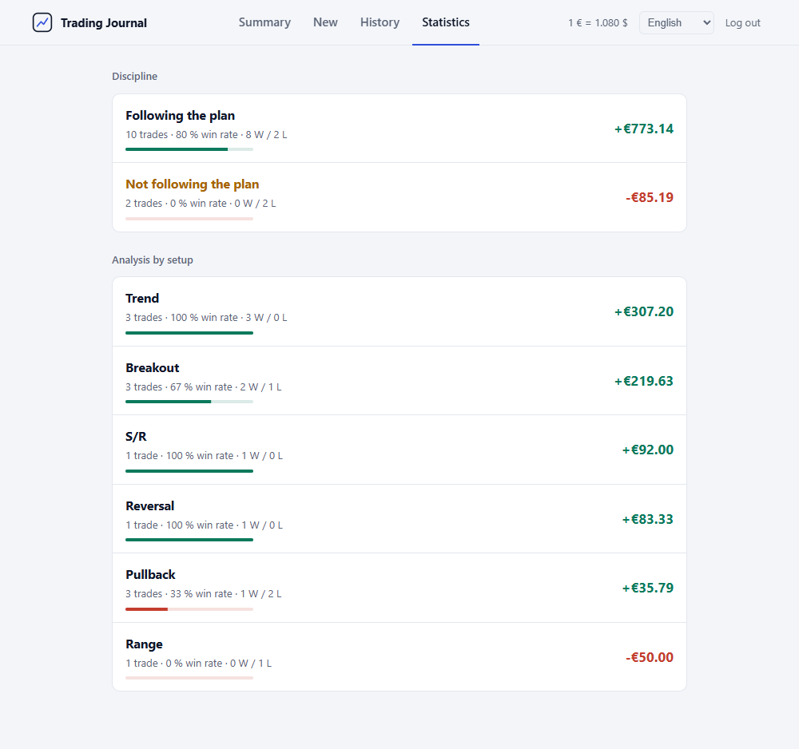
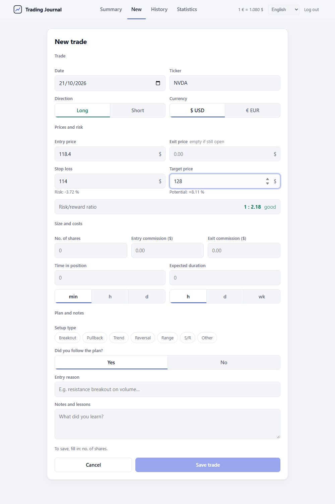
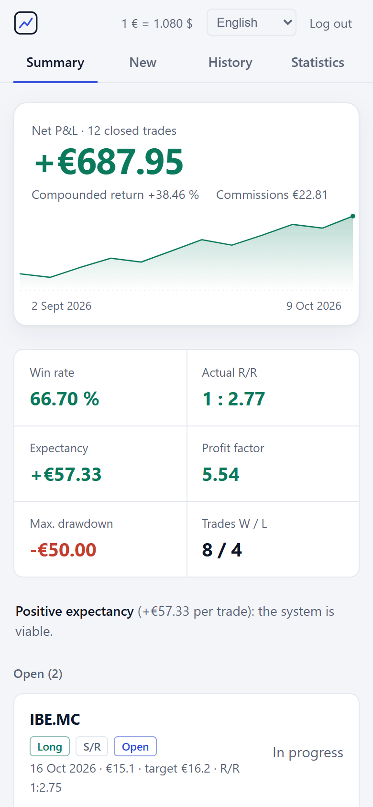

<div align="center">

# Trading Journal

**A self-hosted journal for recording trade decisions and reviewing the results.**

[](https://github.com/nmc03/trading-journal/actions/workflows/ci.yml)
[](LICENSE)
[](https://nodejs.org/)

**English** · [Español](README.es.md) · [Français](README.fr.md) · [Deutsch](README.de.md) · [Português](README.pt.md)

</div>

<p align="center">
  
</p>

<p align="center"><sub>The demo and every screenshot use synthetic data.</sub></p>

## What it is

Trading Journal is a single-user web app. You log each trade with the reason for entry, the plan, the stop and the target. It then calculates your results and shows which setups and habits pay off.

Your data stays in a SQLite database on the machine that runs the app. There is no cloud account, no subscription and no telemetry.

**Good fit for:**

- An individual trader who wants a private record on their own machine or home network.
- Reviewing whether you followed your plan, and how that affects results.
- Keeping a local CSV or JSON copy of your trades.

**Not for:**

- Several users or teams sharing one journal.
- Automatic import from a broker. Only CSV files exported by this app can be imported.
- Tax reporting or investment advice.

## Features

- **Journal:** long and short trades; entry, exit, stop, target, position size, commissions; EUR and USD with a configurable EUR/USD rate; setup type and whether the plan was followed.
- **Review:** risk/reward preview before saving; win rate, realised R/R, expectancy, profit factor, max drawdown and cumulative P&L curve; breakdown by setup and by plan discipline.
- **Data:** history with search and open/closed filter; delete with confirmation; CSV export (spreadsheet-formula safe); JSON export; CSV import of files exported by the app.
- **Interface:** light and dark themes, following the system `prefers-color-scheme` setting; desktop and mobile layouts; UI in Spanish, English, French, German and Portuguese. The language follows the browser and can be changed in the app.
- **Self-hosting:** Node.js 24 or Docker; login with 8-hour JWTs; no built-in HTTPS.

## Screenshots

| Light theme | Dark theme |
| --- | --- |
|  |  |

| History | Stats | New trade |
| --- | --- | --- |
|  |  |  |

<p align="center">
  
</p>

## Quick start

You need Node.js 24, or Docker.

```bash
git clone https://github.com/nmc03/trading-journal.git
cd trading-journal
cp backend/.env.example backend/.env
```

Edit `backend/.env` and replace the example values:

- `TJ_PASSWORD`: your login password. The app refuses to start with the example value.
- `JWT_SECRET`: a random string of at least 32 characters. Generate one with `openssl rand -base64 48`.

### Option A: plain Node.js

```bash
cd frontend
npm ci
npm run build
```

This builds the UI into `frontend/dist`. Now start the server from `backend/`. Two settings tell it where to keep the database (`DATA_DIR`) and which built UI to serve (`STATIC_DIR`). Both paths are relative to the folder you start the server from.

```bash
cd ../backend
npm ci
DATA_DIR=../data STATIC_DIR=../frontend/dist node --env-file=.env server.js
```

On Windows PowerShell:

```powershell
cd ../backend
npm ci
$env:DATA_DIR = "../data"; $env:STATIC_DIR = "../frontend/dist"; node --env-file=.env server.js
```

Open <http://localhost:3001>.

> Pass `DATA_DIR` and `STATIC_DIR` on the command line, as above, and do not add them to `backend/.env`. Docker reads that same file and expects its own defaults.

For development with hot reload, keep the backend running and run `npm run dev` in `frontend/`. Vite serves the UI on <http://localhost:5173> and proxies `/api` to port 3001.

### Option B: Docker

```bash
docker compose up -d --build
```

Open <http://localhost:8080>. To use another host port in PowerShell, run `$env:HTTP_PORT=8088; docker compose up -d`. In bash, run `HTTP_PORT=8088 docker compose up -d`.

> **Security notice.** The app has no built-in HTTPS. Use it on localhost, your LAN or a VPN. Docker publishes the port on all interfaces. If the app is reachable from an untrusted network, put an HTTPS reverse proxy in front of it and set `TRUST_PROXY_HOPS=1`.

## Configuration

Set these in `backend/.env`.

| Variable | Required | Purpose |
| --- | --- | --- |
| `TJ_USER` | Yes | Login username |
| `TJ_PASSWORD` | Yes | Login password. Must not be the example value |
| `JWT_SECRET` | Yes | Random secret, at least 32 characters. Must not be the example value |
| `PORT` | No | API port. Default `3001`. Leave it at `3001` with Docker |
| `DATA_DIR` | No | Folder for `trading.db`. Default `/app/data`, which is what Docker uses. For Option A, pass `../data` on the command line |
| `STATIC_DIR` | No | Folder with the built UI. Default `backend/public`, which is where the Docker image puts it. For Option A, pass `../frontend/dist` on the command line |
| `TRUST_PROXY_HOPS` | No | Number of reverse proxies in front of the app. Default `0`. Use `1` only behind an HTTPS reverse proxy such as Caddy or Traefik |
| `CORS_ORIGIN` | No | Comma-separated origins allowed to call the API, for a frontend on another origin. Off by default |

Docker Compose also reads `HTTP_PORT` (default `8080`) from the shell environment. It sets the host port.

## Backups, restore and updating

All journal data is in `data/trading.db`, inside the `data/` folder. Git ignores `data/` and `.env` files.

Stop the app before you copy the data. The database uses SQLite WAL mode, so a copy taken while the app runs may be incomplete.

Back up with Docker:

```bash
docker compose stop app
tar -czf trading-journal-data.tar.gz data/
docker compose start app
```

Restore with Docker:

```bash
docker compose stop app
mv data data.before-restore
tar -xzf trading-journal-data.tar.gz
docker compose start app
```

Delete `data.before-restore` once the restore works. Keep backup archives outside the project folder.

For Node.js, stop the server with `Ctrl+C`, copy or restore the `data/` folder, and start the server again.

To update a Docker deployment, back up `data/` first, then run:

```bash
git pull
docker compose up -d --build
```

Rebuilding does not remove the bind-mounted `data/` folder.

For a long-running deployment, use your normal host-level backup process and store copies on another machine.

## Languages

The UI picks a language in this order:

1. The language saved in the browser under `tj_lang`, if the user chose one.
2. The first supported language in the browser's language list.
3. Spanish, the default.

The API uses the `Accept-Language` header to choose the language of error messages.

Supported languages: Spanish (`es`), English (`en`), French (`fr`), German (`de`) and Portuguese (`pt`).

To add a language:

1. Copy `frontend/src/lib/locales/es.js` to `frontend/src/lib/locales/xx.js` and translate the values. Keep the keys the same.
2. Add the API messages to `MESSAGES` in `backend/i18n.js`, with the same keys and `{variables}` as `es`.
3. Register the language in `LANGS` in `frontend/src/lib/i18n.js`, with a `label`, a `locale` such as `en-GB`, and the imported dictionary.
4. Run `npm test` in `backend/` and in `frontend/`. The tests fail if a key or `{variable}` is missing.

## Metrics glossary

Metrics use closed trades only: trades with an entry price, an exit price and a position size. Amounts are in EUR. Source: `frontend/src/lib/calc.js`.

- **P&L:** longs `(exit - entry) x shares`; shorts `(entry - exit) x shares`; minus entry and exit commissions. USD amounts are divided by the EUR/USD rate you set (default `1.08`).
- **Win rate:** trades with a P&L above zero / closed trades x 100.
- **Realised R/R:** average winning P&L / average losing P&L (absolute values).
- **Expectancy:** total P&L / closed trades. Break-even trades count as zero.
- **Profit factor:** gross profit / gross loss. Shown as `∞` when there are no losing trades.
- **Max drawdown:** largest fall from a peak to a later low on the cumulative P&L curve.
- **Cumulative P&L curve:** running sum of each trade's P&L, in trade-date order.
- **Compounded return:** product of `(1 + trade %)` over all closed trades, minus 1. Trade % is the price move in the direction of the trade, before commissions.
- **Setup analysis** and **plan discipline:** the metrics above, grouped by setup type or by whether the plan was followed.

The compounded return is a theoretical chain of trade results. It is not a time-weighted return (TWR) or a money-weighted return (MWR). It ignores deposits, withdrawals, position size and timing, so it can differ from your broker's figure.

## Security and privacy

- Passwords are checked with bcrypt. The app refuses to start with the example password or a `JWT_SECRET` shorter than 32 characters.
- Login tokens are JWTs signed with HS256 and valid for 8 hours.
- Login attempts are limited to 10 per 15 minutes per client.
- Request bodies are limited to 100 KB. The API validates every field. SQL queries use bound parameters.
- Helmet sends security headers, including `Content-Security-Policy: default-src 'self'`. CORS is off unless `CORS_ORIGIN` is set.
- The app sends no telemetry, analytics or third-party requests, and sets no cookies. The login token is kept in the browser's `localStorage` under `tj_token`.

The app has no built-in TLS. See [SECURITY.md](SECURITY.md) for supported versions and how to report a vulnerability. See [PRIVACY.md](PRIVACY.md) for what is stored and where.

## Development

Backend:

```bash
cd backend
npm ci
npm test
npm run check
npm audit --omit=dev --audit-level=high
```

Frontend:

```bash
cd frontend
npm ci
npm test
npm run build
npm audit --audit-level=high
```

The calculation logic is pure and has no React or DOM code: `frontend/src/lib/calc.js`. Its tests are in `calc.test.js`.

CI runs the backend and frontend checks, validates `docker-compose.yml` and builds the Docker image. To regenerate the screenshots and demo GIFs, see [CONTRIBUTING.md](CONTRIBUTING.md#regenerating-screenshots-and-demo-gifs).

## FAQ

**The app refuses to start. Why?**
Check `backend/.env`. The example password and example `JWT_SECRET` are rejected on purpose. `JWT_SECRET` must be at least 32 characters.

**Can I use it from my phone or another computer?**
Yes, if the machine that runs the journal is reachable on your network. The app serves plain HTTP. Expose it beyond your own network only behind an HTTPS reverse proxy.

**Why does my compounded return differ from my broker's return?**
The journal chains the percentage result of each closed trade. It does not account for deposits, withdrawals or position size. See the [metrics glossary](#metrics-glossary).

## Contributing

Focused fixes and improvements are welcome. Read [CONTRIBUTING.md](CONTRIBUTING.md) before you open a pull request. This is a personal project, not a commercial product.

## Disclaimer

Trading Journal is a record-keeping and analysis tool. It gives no investment advice, brokerage services or guarantees about trading results.

## License

Released under the [MIT License](LICENSE).
