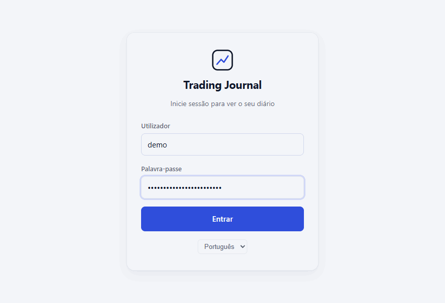
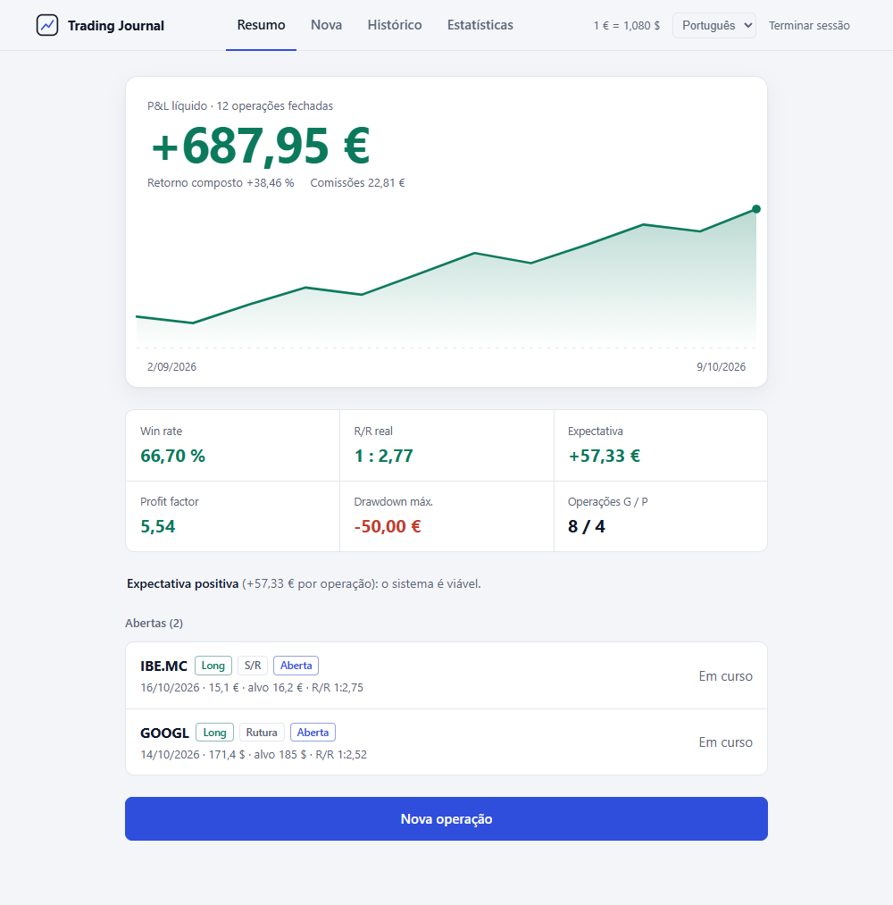
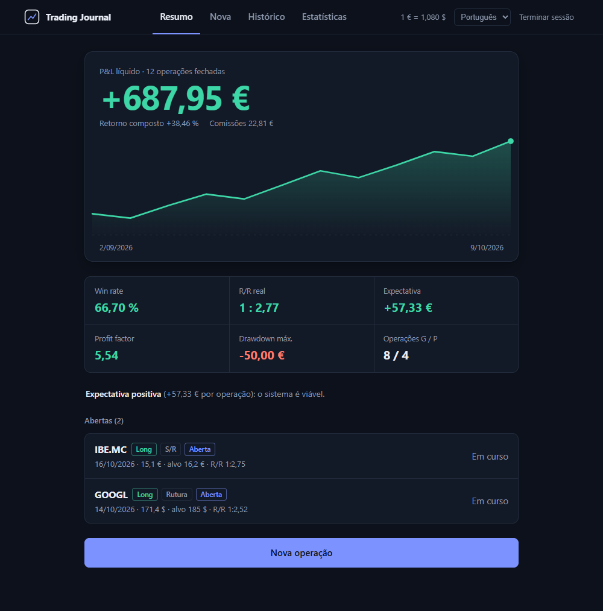
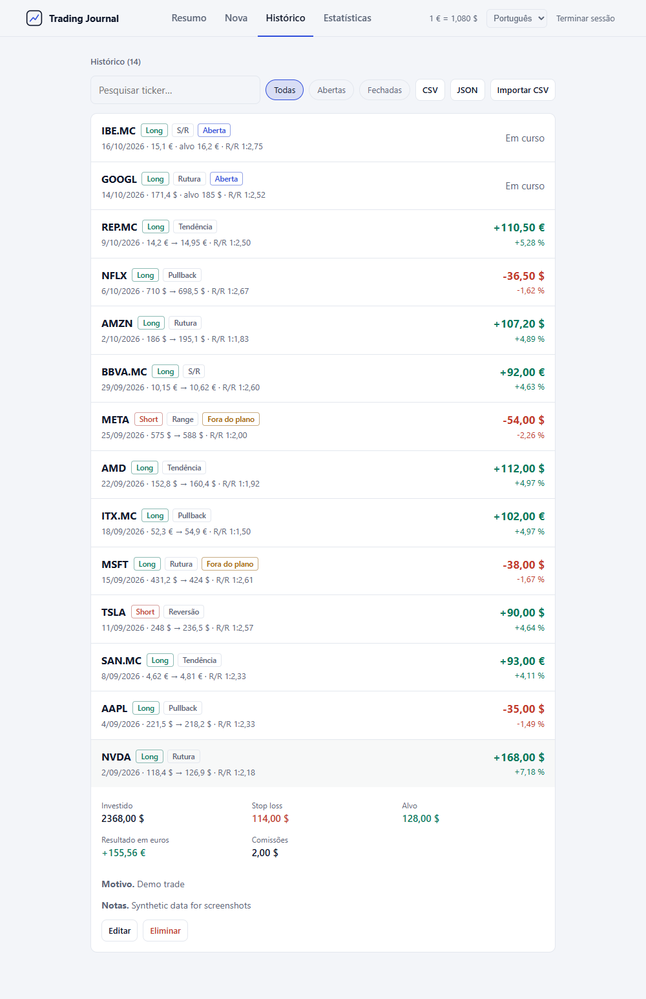
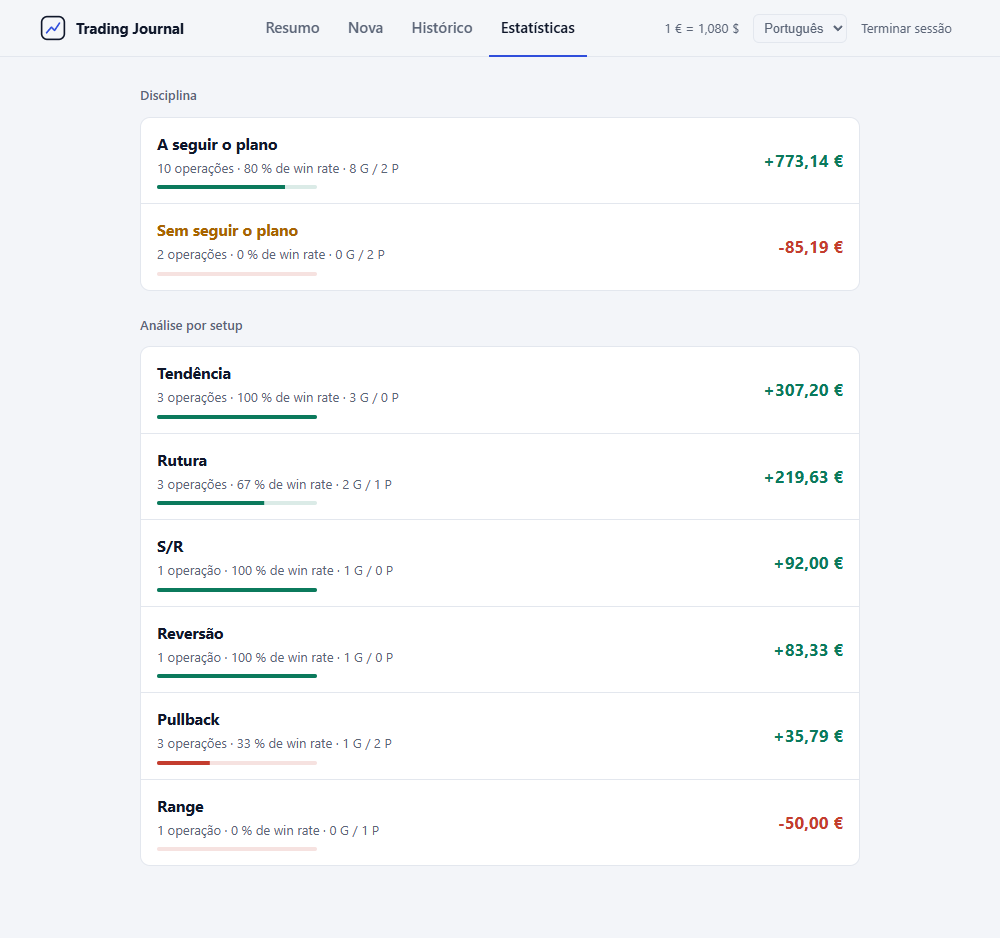
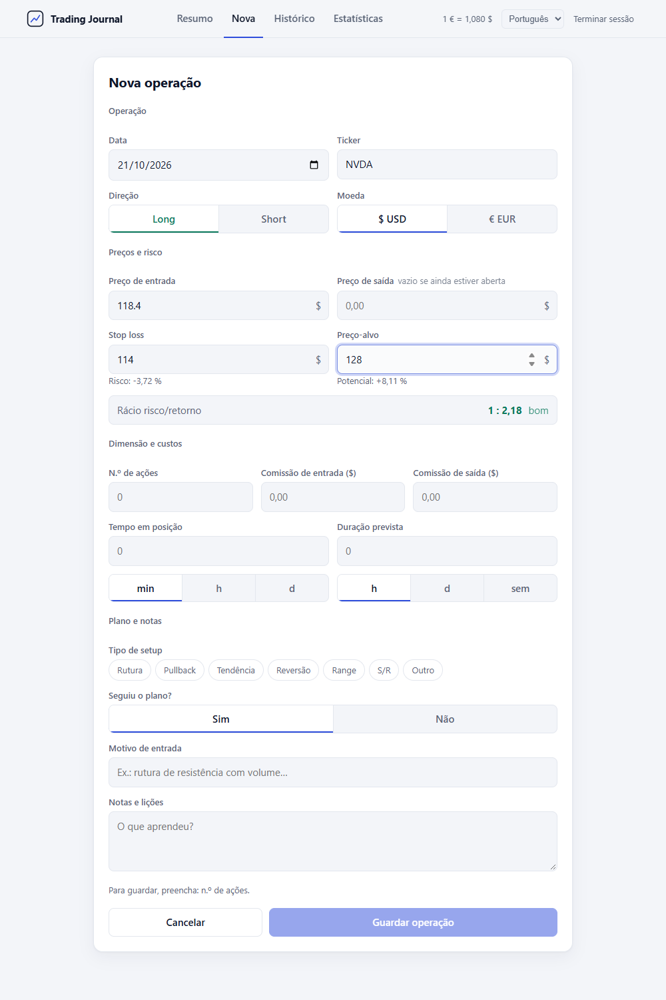
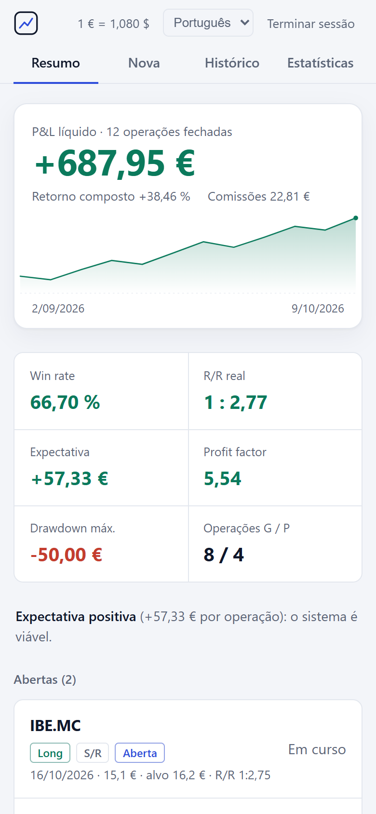

<div align="center">

# Trading Journal

**Um diário de trading auto-hospedado para registar as decisões e rever os resultados.**

[](https://github.com/nmc03/trading-journal/actions/workflows/ci.yml)
[](LICENSE)
[](https://nodejs.org/)

[English](README.md) · [Español](README.es.md) · [Français](README.fr.md) · [Deutsch](README.de.md) · **Português**

</div>

<p align="center">
  
</p>

<p align="center"><sub>A demonstração e todas as capturas de ecrã usam dados sintéticos.</sub></p>

## O que é

O Trading Journal é uma aplicação web para um único utilizador. Regista cada operação com o motivo de entrada, o plano, o stop e o alvo. Depois calcula os resultados e mostra que setups e hábitos compensam.

Os seus dados ficam numa base de dados SQLite na máquina que executa a aplicação. Não há conta na nuvem, nem subscrição, nem telemetria.

**Indicado para:**

- Um trader individual que quer um registo privado na sua própria máquina ou na rede de casa.
- Rever se seguiu o plano e como isso afeta os resultados.
- Manter uma cópia local em CSV ou JSON das suas operações.

**Não indicado para:**

- Vários utilizadores ou equipas a partilhar o mesmo diário.
- Importação automática a partir de uma corretora. Só se podem importar ficheiros CSV exportados por esta aplicação.
- Declarações fiscais ou aconselhamento de investimento.

## Funcionalidades

- **Diário:** operações longas e curtas; entrada, saída, stop, alvo, tamanho da posição e comissões; EUR e USD com uma taxa EUR/USD configurável; tipo de setup e se o plano foi seguido.
- **Revisão:** pré-visualização do rácio risco/retorno antes de guardar; win rate, R/R real, expectativa, profit factor, drawdown máximo e curva de P&L acumulado; análise por setup e por disciplina no plano.
- **Dados:** histórico com pesquisa e filtro abertas/fechadas; eliminação com confirmação; exportação CSV (protegida contra fórmulas de folhas de cálculo); exportação JSON; importação CSV de ficheiros exportados pela aplicação.
- **Interface:** temas claro e escuro, seguindo a definição `prefers-color-scheme` do sistema; layouts para computador e telemóvel; interface em espanhol, inglês, francês, alemão e português. O idioma segue o navegador e pode ser alterado na aplicação.
- **Alojamento próprio:** Node.js 24 ou Docker; início de sessão com JWT válidos 8 horas; sem HTTPS incorporado.

## Capturas de ecrã

| Tema claro | Tema escuro |
| --- | --- |
|  |  |

| Histórico | Estatísticas | Nova operação |
| --- | --- | --- |
|  |  |  |

<p align="center">
  
</p>

## Início rápido

Precisa de Node.js 24 ou de Docker.

```bash
git clone https://github.com/nmc03/trading-journal.git
cd trading-journal
cp backend/.env.example backend/.env
```

Edite `backend/.env` e substitua os valores de exemplo:

- `TJ_PASSWORD`: a sua palavra-passe de início de sessão. A aplicação recusa arrancar com o valor de exemplo.
- `JWT_SECRET`: uma cadeia aleatória com pelo menos 32 caracteres. Gere uma com `openssl rand -base64 48`.

### Opção A: Node.js simples

```bash
cd frontend
npm ci
npm run build
```

Isto compila a interface em `frontend/dist`. Depois, arranque o servidor a partir de `backend/`. Duas definições indicam onde guardar a base de dados (`DATA_DIR`) e qual a interface compilada a servir (`STATIC_DIR`). Ambos os caminhos são relativos à pasta a partir da qual arranca o servidor.

```bash
cd ../backend
npm ci
DATA_DIR=../data STATIC_DIR=../frontend/dist node --env-file=.env server.js
```

No PowerShell do Windows:

```powershell
cd ../backend
npm ci
$env:DATA_DIR = "../data"; $env:STATIC_DIR = "../frontend/dist"; node --env-file=.env server.js
```

Abra <http://localhost:3001>.

> Passe `DATA_DIR` e `STATIC_DIR` na linha de comandos, como acima, e não os adicione a `backend/.env`. O Docker lê esse mesmo ficheiro e tem os seus próprios valores por omissão.

Para desenvolvimento com recarregamento a quente, mantenha o backend em execução e execute `npm run dev` em `frontend/`. O Vite serve a interface em <http://localhost:5173> e encaminha `/api` para a porta 3001.

### Opção B: Docker

```bash
docker compose up -d --build
```

Abra <http://localhost:8080>. Para usar outra porta do host no PowerShell, execute `$env:HTTP_PORT=8088; docker compose up -d`. No bash, execute `HTTP_PORT=8088 docker compose up -d`.

> **Aviso de segurança.** A aplicação não tem HTTPS incorporado. Use-a em localhost, na sua rede local ou numa VPN. O Docker publica a porta em todas as interfaces. Se a aplicação for acessível a partir de uma rede não fiável, coloque à frente um proxy inverso HTTPS e defina `TRUST_PROXY_HOPS=1`.

## Configuração

Defina estes valores em `backend/.env`.

| Variável | Obrigatória | Finalidade |
| --- | --- | --- |
| `TJ_USER` | Sim | Nome de utilizador para o início de sessão |
| `TJ_PASSWORD` | Sim | Palavra-passe para o início de sessão. Não pode ser o valor de exemplo |
| `JWT_SECRET` | Sim | Segredo aleatório, com pelo menos 32 caracteres. Não pode ser o valor de exemplo |
| `PORT` | Não | Porta da API. Por omissão `3001`. Mantenha `3001` com Docker |
| `DATA_DIR` | Não | Pasta de `trading.db`. Por omissão `/app/data`, que é o que o Docker usa. Na opção A, passe `../data` na linha de comandos |
| `STATIC_DIR` | Não | Pasta com a interface compilada. Por omissão `backend/public`, onde a imagem Docker a coloca. Na opção A, passe `../frontend/dist` na linha de comandos |
| `TRUST_PROXY_HOPS` | Não | Número de proxies inversos à frente da aplicação. Por omissão `0`. Use `1` apenas atrás de um proxy inverso HTTPS, como o Caddy ou o Traefik |
| `CORS_ORIGIN` | Não | Origens separadas por vírgulas autorizadas a chamar a API, para um frontend noutra origem. Desativado por omissão |

O Docker Compose também lê `HTTP_PORT` (por omissão `8080`) do ambiente do shell. Define a porta do host.

## Cópias de segurança, restauro e atualização

Todos os dados do diário estão em `data/trading.db`, dentro da pasta `data/`. O Git ignora `data/` e os ficheiros `.env`.

Pare a aplicação antes de copiar os dados. A base de dados usa o modo WAL do SQLite, por isso uma cópia feita com a aplicação em execução pode ficar incompleta.

Cópia de segurança com Docker:

```bash
docker compose stop app
tar -czf trading-journal-data.tar.gz data/
docker compose start app
```

Restauro com Docker:

```bash
docker compose stop app
mv data data.before-restore
tar -xzf trading-journal-data.tar.gz
docker compose start app
```

Apague `data.before-restore` quando o restauro funcionar. Guarde as cópias de segurança fora da pasta do projeto.

Em Node.js, pare o servidor com `Ctrl+C`, copie ou restaure a pasta `data/` e volte a arrancar o servidor.

Para atualizar uma instalação Docker, faça primeiro uma cópia de `data/` e depois execute:

```bash
git pull
docker compose up -d --build
```

Reconstruir a imagem não remove a pasta `data/` montada (bind mount).

Numa instalação de funcionamento contínuo, use o seu processo habitual de cópias de segurança ao nível do sistema e guarde as cópias noutra máquina.

## Idiomas

A interface escolhe o idioma por esta ordem:

1. O idioma guardado no navegador em `tj_lang`, se o utilizador o tiver escolhido.
2. O primeiro idioma suportado na lista de idiomas do navegador.
3. Espanhol, o idioma por omissão.

A API usa o cabeçalho `Accept-Language` para escolher o idioma das mensagens de erro.

Idiomas suportados: espanhol (`es`), inglês (`en`), francês (`fr`), alemão (`de`) e português (`pt`).

Para adicionar um idioma:

1. Copie `frontend/src/lib/locales/es.js` para `frontend/src/lib/locales/xx.js` e traduza os valores. Mantenha as mesmas chaves.
2. Acrescente as mensagens da API a `MESSAGES` em `backend/i18n.js`, com as mesmas chaves e `{variables}` de `es`.
3. Registe o idioma em `LANGS` em `frontend/src/lib/i18n.js`, com um `label`, um `locale` como `en-GB` e o dicionário importado.
4. Execute `npm test` em `backend/` e em `frontend/`. Os testes falham se faltar alguma chave ou `{variável}`.

## Glossário de métricas

As métricas usam apenas operações fechadas: operações com preço de entrada, preço de saída e tamanho de posição. Os valores estão em EUR. Fonte: `frontend/src/lib/calc.js`.

- **P&L:** longas `(saída - entrada) x ações`; curtas `(entrada - saída) x ações`; menos as comissões de entrada e de saída. Os valores em USD são divididos pela taxa EUR/USD que definir (por omissão `1,08`).
- **Win rate:** operações com P&L acima de zero / operações fechadas x 100.
- **R/R real:** P&L médio das operações vencedoras / P&L médio das perdedoras (valores absolutos).
- **Expectativa:** P&L total / operações fechadas. As operações de equilíbrio contam como zero.
- **Profit factor:** lucro bruto / perda bruta. Mostra-se como `∞` quando não há operações perdedoras.
- **Drawdown máximo:** maior queda, de um pico até um mínimo posterior, na curva de P&L acumulado.
- **Curva de P&L acumulado:** soma progressiva do P&L de cada operação, por ordem de data.
- **Retorno composto:** produto de `(1 + % da operação)` em todas as operações fechadas, menos 1. A % da operação é a variação do preço no sentido da operação, antes das comissões.
- **Análise por setup** e **disciplina no plano:** as métricas acima, agrupadas por tipo de setup ou por se o plano foi seguido.

O retorno composto é uma cadeia teórica de resultados. Não é um retorno ponderado pelo tempo (TWR) nem pelo dinheiro (MWR). Ignora depósitos, levantamentos, tamanho da posição e momento, por isso pode diferir do valor indicado pela sua corretora.

## Segurança e privacidade

- As palavras-passe são verificadas com bcrypt. A aplicação recusa arrancar com a palavra-passe de exemplo ou com um `JWT_SECRET` com menos de 32 caracteres.
- Os tokens de início de sessão são JWT assinados com HS256 e válidos durante 8 horas.
- As tentativas de início de sessão estão limitadas a 10 por cada 15 minutos, por cliente.
- Os pedidos estão limitados a 100 KB. A API valida todos os campos. As consultas SQL são parametrizadas.
- O Helmet envia cabeçalhos de segurança, incluindo `Content-Security-Policy: default-src 'self'`. O CORS está desativado, a não ser que `CORS_ORIGIN` esteja definido.
- A aplicação não envia telemetria, análises nem pedidos a terceiros, e não define cookies. O token de início de sessão fica no `localStorage` do navegador, na chave `tj_token`.

A aplicação não tem TLS incorporado. Veja [SECURITY.md](SECURITY.md) (em inglês) para as versões suportadas e para saber como reportar uma vulnerabilidade. Veja [PRIVACY.md](PRIVACY.md) (em inglês) para saber o que é guardado e onde.

## Desenvolvimento

Backend:

```bash
cd backend
npm ci
npm test
npm run check
npm audit --omit=dev --audit-level=high
```

Frontend:

```bash
cd frontend
npm ci
npm test
npm run build
npm audit --audit-level=high
```

A lógica de cálculo é pura, sem código React nem DOM: `frontend/src/lib/calc.js`. Os seus testes estão em `calc.test.js`.

O CI executa as verificações do backend e do frontend, valida o `docker-compose.yml` e constrói a imagem Docker. Para regenerar as capturas de ecrã e os GIF de demonstração, veja [CONTRIBUTING.md](CONTRIBUTING.md#regenerating-screenshots-and-demo-gifs) (em inglês).

## Perguntas frequentes

**A aplicação não arranca. Porquê?**
Verifique o `backend/.env`. A palavra-passe e o `JWT_SECRET` de exemplo são recusados de propósito. O `JWT_SECRET` tem de ter pelo menos 32 caracteres.

**Posso usá-la a partir do telemóvel ou de outro computador?**
Sim, se a máquina que executa o diário estiver acessível na sua rede. A aplicação serve HTTP sem cifragem. Exponha-a para lá da sua rede apenas atrás de um proxy inverso HTTPS.

**Porque é que o meu retorno composto difere do da minha corretora?**
O diário encadeia o resultado percentual de cada operação fechada. Não tem em conta depósitos, levantamentos nem o tamanho da posição. Veja o [Glossário de métricas](#glossário-de-métricas).

## Contribuição

Correções e melhorias pontuais são bem-vindas. Leia o [CONTRIBUTING.md](CONTRIBUTING.md) (em inglês) antes de abrir um pull request. Este é um projeto pessoal, não um produto comercial.

## Aviso legal

O Trading Journal é uma ferramenta de registo e análise. Não oferece aconselhamento de investimento, serviços de corretagem nem garantias sobre os resultados de trading.

## Licença

Publicado sob a [Licença MIT](LICENSE).
